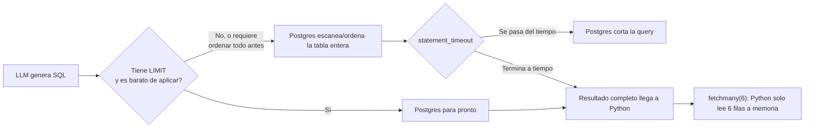
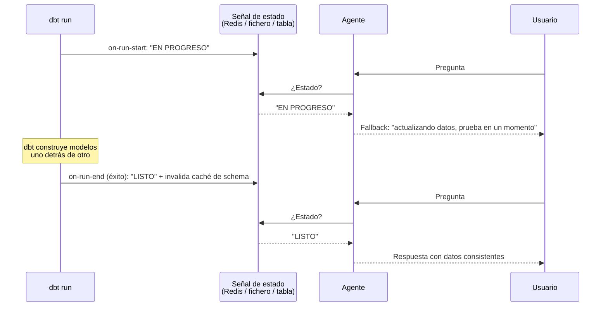
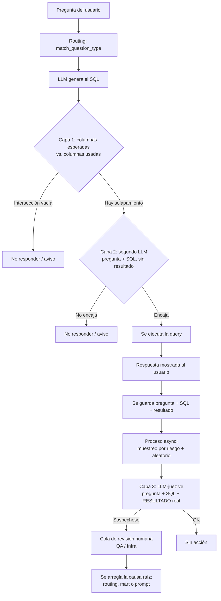
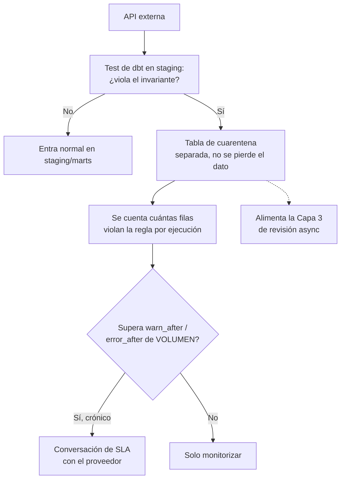
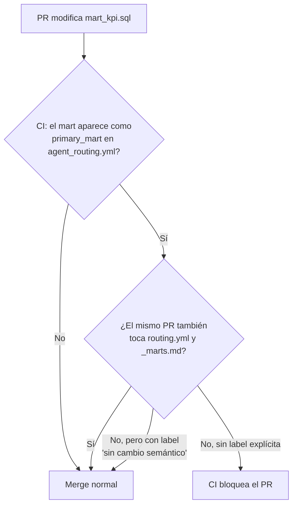
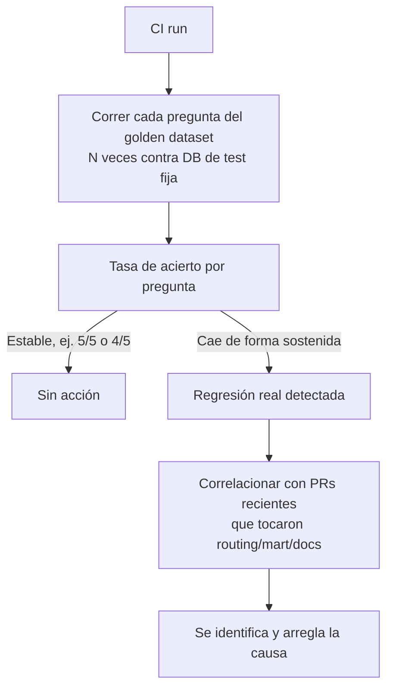
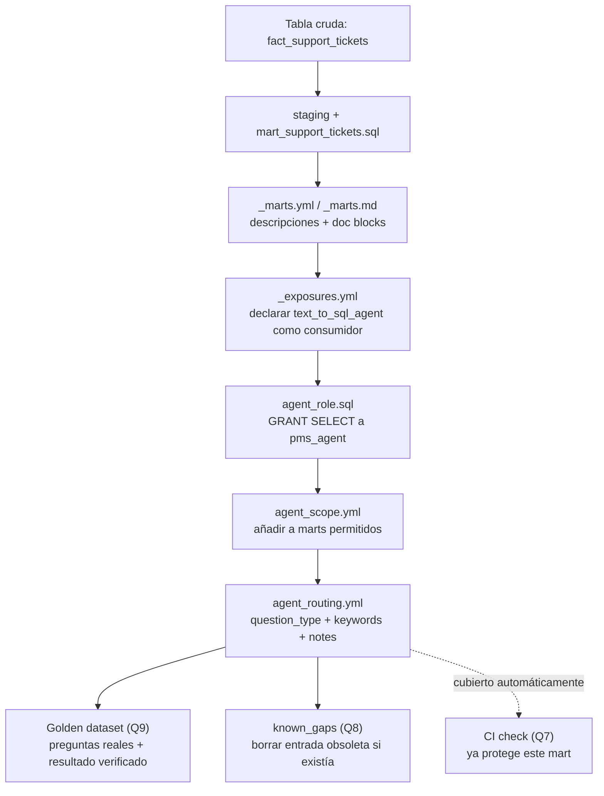

# Interview Prep — El recorrido completo, pregunta por pregunta

> Material de estudio del proyecto [pms-semantic-layer](https://github.com/moradabaz/pms-semantic-layer). Continúa desde [03-live-agent.md](03-live-agent.md). Los posts que se mencionan a lo largo de este documento viven en [`content/en/`](https://github.com/moradabaz/pms-semantic-layer/tree/main/content/en) de ese repositorio.

Este documento no es un resumen — es el camino real que seguimos para entender cada pregunta que un Staff Data Engineer hizo al leer los 6 posts de la serie. Cada pregunta se rompió en piezas pequeñas, con una corrección cada vez que hacía falta, hasta llegar a una respuesta que se puede defender de verdad en una entrevista, no recitar de memoria.

---

## Pregunta 1 — `fetchmany(6)` vs `statement_timeout`

**La pregunta real de tu amigo**: *"`fetchmany(6)` limita filas, pero ¿qué pasa si el modelo genera un `SELECT *` sobre una tabla de millones de filas? ¿El cursor ya ha ejecutado el full scan antes del `fetchmany`? ¿Cómo lo manejarías con un `statement_timeout` en Postgres?"*

### Cómo lo construimos

1. **Primera pregunta de control**: ¿en qué momento se ejecuta la query — en `execute()` o en `fetchmany()`? → Respuesta correcta: en `execute()`.
2. **La corrección clave**: `fetchmany(6)` **no es un `LIMIT`**. Un `LIMIT` se escribe dentro del SQL y le dice a Postgres "para de trabajar en cuanto tengas 6 filas" — Postgres deja de escanear antes de tiempo. `fetchmany(6)` no le dice nada a Postgres: Postgres ya ha hecho **todo** el trabajo (escanear la tabla entera, encontrar todo lo que matchea, mandarlo todo por la red) antes de que tu código llame a `fetchmany`. `fetchmany` solo dice "de todo lo que ya me mandaste, dame primero 6".
3. **Comprobación con números**: si la tabla tiene 10 millones de filas y no hay `WHERE` ni `LIMIT`, ¿cuántas filas lee y manda Postgres? → 10 millones. `fetchmany(6)` no cambia esto ni un poco.
4. **Analogía para que se quede grabada**: es como si te mandaran un camión con 10 millones de cartas y tú solo abrieras 6 — el camión entero ya hizo el viaje, aunque tú solo mires 6.
5. **Mi objeción real**: pensé que un `LIMIT` bastaría, y dudé de `statement_timeout` porque no sabía qué número de segundos poner (¿5s? ¿6s? ¿y si la query tarda justo eso?).
6. **Corrección 1 — el `LIMIT` tampoco es infalible**: `SELECT * FROM tabla_enorme ORDER BY revenue DESC LIMIT 6` puede obligar a Postgres a **ordenar la tabla entera primero**, y solo después coger las 6 de arriba. El `LIMIT` no evita el trabajo caro en ese caso.
7. **Corrección 2 — el `statement_timeout` no es precisión quirúrgica**: no se trata de adivinar el segundo exacto en el que una query "se vuelve mala". Es un margen generoso: si tus queries normales tardan medio segundo, pones el timeout en 5-10 segundos — no para cazar una query que tarda "justo 6 segundos", sino para cortar algo que se quedaría colgado **minutos** (un `JOIN` sin condición, una tabla sin índice).
8. **La pregunta que lo cierra todo**: ¿usarías solo una de las tres cosas (`LIMIT`, `fetchmany`, `statement_timeout`), o las tres juntas? → **Las tres juntas, cada una cubre lo que las otras no cubren.**

### Respuesta final para la entrevista

- `LIMIT` (en el SQL) — intenta evitar el trabajo caro. No siempre lo consigue (si hay que ordenar todo antes).
- `statement_timeout` — la red de seguridad dura: corta a Postgres si se pasa de tiempo, pase lo que pase.
- `fetchmany` — protege tu propio programa Python, para no cargar en memoria lo que Postgres ya mandó.

> **Frase para memorizar**: "Ninguna de las tres, por sí sola, resuelve el problema completo — son tres capas, cada una defendiendo contra lo que las otras no ven."

---

## Pregunta 2 — `information_schema` a escala, caché con hooks de dbt, y cold start

**La pregunta real**: *"¿Has considerado cachear el schema context o invalidarlo con un hook de dbt? En un warehouse con 200 tablas, ¿un query a `information_schema` por cada pregunta escalaría? ¿Cómo manejarías el cold-start si el `dbt run` aún no ha terminado?"*

Esta pregunta tiene 3 partes. Fuimos una por una.

### Parte 1 — ¿Escala a 200 tablas?

1. **Lo básico primero**: `information_schema` es un conjunto de tablas que Postgres mantiene automáticamente, describiendo la estructura de tus **otras** tablas (qué columnas tiene cada una, de qué tipo). Es como el índice de un libro — no es el contenido, dice dónde está cada cosa.
2. **¿Para qué lo usamos en el capítulo 13?** → Para no confiar en que la documentación (el YAML) esté sincronizada con la realidad — le preguntamos directamente a Postgres "¿cómo eres tú ahora mismo?".
3. **La separación clave**: hay dos costes distintos que no hay que confundir — (a) preguntarle a Postgres su propio catálogo, y (b) mandarle ese texto a un LLM. ¿Cuál es más caro? → **Mandar el texto al LLM**, porque implica gasto de tokens y contexto. Preguntar a Postgres es barato — es un catálogo indexado, rápido aunque haya miles de tablas.
4. **La conexión con el routing**: si el warehouse tuviera 200 tablas y el routing decide que la pregunta es de tipo `occupancy`, ¿a cuántas de esas 200 le preguntamos a `information_schema`, y cuántas acaban en el prompt? → **1 o 2, las mismas.**
5. **Conclusión**: sí, escalaría — porque el número total de tablas del warehouse **nunca importa**. Lo único que importa es cuántas tablas necesita **esa pregunta concreta**, y eso lo decide el routing, no el tamaño del warehouse.

### Parte 2 — Caché + hook de dbt

1. **Qué es un hook, desde cero**: código que se ejecuta automáticamente cuando pasa algo concreto, sin que tú tengas que lanzarlo a mano. Analogía: una alarma de coche que salta sola al abrir la puerta — no la activas cada vez, está enganchada al evento.
2. **¿A qué evento engancharíamos un hook para reaccionar cuando `dbt run` cambia algo?** → Al terminar el run. Eso es literalmente el hook `on-run-end` de dbt (y `on-run-start` para el inicio).
3. **Por qué le importa esto a un caché**: si cacheáramos la info del esquema para ir más rápido, ese caché se queda desactualizado en el momento en que alguien cambia una columna. El hook `on-run-end` sería el sitio perfecto para decir "el esquema acaba de cambiar, borra esa parte del caché" — automáticamente.
4. **¿Por qué en nuestro proyecto real NO cacheamos nada?** → Mi respuesta: no queríamos añadir esa complejidad todavía, sería una mejora de "v2". Correcto, y además: como ya vimos que el query a `information_schema` es barato, no había ningún problema real de rendimiento que justificara meter caché + hook desde el principio. No se añade complejidad para un problema que no existe.
5. **Mi pregunta propia, muy buena**: si con 10.000 tablas `information_schema` sigue siendo barato, ¿cuándo haría falta el hook de verdad? → La variable correcta no es el número de tablas, es el **volumen de preguntas por segundo (QPS)**. Con 5 preguntas al día, el pequeño coste extra no importa. Con 1.000 preguntas/segundo, sí.
6. **Mi segunda pregunta propia, todavía mejor**: con 1.000 preguntas/segundo y 10.000 tablas, si cambia el esquema de alguna tabla que se está usando, ¿no habría problemas de escalabilidad al consultar la caché? → Esto es el problema real llamado **cache invalidation** — tan famoso que hay un chiste real en programación: *"hay dos cosas difíciles en informática: invalidar cachés, y ponerle nombre a las cosas."* No es que se me escapara algo obvio, es un problema genuinamente difícil.
7. **La solución (nunca perfecta)**: el hook `on-run-end` invalida el caché en el momento exacto en que algo cambia, más un **TTL corto** (Time To Live, "esto caduca a los 60 segundos pase lo que pase") como red de seguridad por si el hook falla.
8. **¿Desaparece el problema del todo?** → No, **queda una ventana pequeña** de tiempo en la que el caché podría estar equivocado. Nunca desaparece del todo, solo se reduce lo bastante como para ser aceptable. Esta es la respuesta madura — no fingir que hay una solución perfecta.
9. **Mi pregunta sobre dónde vive ese caché**: nivel simple = un diccionario en memoria dentro del propio proceso Python del agente. Problema: si hay **varias copias del agente corriendo en paralelo** (necesario para atender 1.000 preguntas/segundo), cada copia tiene su propio diccionario, separado de las demás — el hook tendría que avisar a todas por separado.
10. **La solución real a eso**: un caché **compartido externo**, típicamente **Redis** — todas las copias del agente hablan con el mismo Redis, el hook invalida una sola vez, y todas las copias lo ven al instante. Y sí, confirmado: eso ya es infraestructura extra real (Redis, quizás Kubernetes para orquestar las copias) — y **solo merece la pena montarlo cuando de verdad tienes ese volumen**.

### Parte 3 — Cold start (el `dbt run` a medias)

1. **Lo básico**: cuando `dbt run` construye, por ejemplo, 20 modelos, ¿los construye todos a la vez o uno detrás de otro? → **Uno detrás de otro** (confirmado mirando los propios logs de dbt).
2. **El problema concreto**: si `mart_aggregates` ya se reconstruyó con lógica nueva, pero a `mart_kpi` (que depende de `mart_aggregates`) todavía no le ha tocado el turno en ese mismo `dbt run` — y justo en ese momento llega una pregunta real que usa `mart_kpi` — ¿qué pasa? → **Los datos no cuadrarían entre las dos tablas, y además podría estar sirviendo información ya desactualizada.** Las dos cosas a la vez.
3. **Primer intento de solución**: "comprobar los metadatos de las tablas/esquemas" — dirección correcta, pero sin la herramienta concreta.
4. **La herramienta real**: dbt genera automáticamente, al terminar cada `dbt run`, un fichero llamado `run_results.json`, que dice si esa ejecución terminó bien o mal. El agente comprobaría ese fichero antes de responder.
5. **Mi objeción, muy afilada**: `run_results.json` se escribe **solo al final** del run. Si un `dbt run` nuevo empieza ahora y tarda 10 minutos, durante esos 10 minutos el fichero sigue diciendo la información del run **de ayer**. Eso no es fiable — ¿cómo sabe el agente que hay un run **en curso ahora mismo**, si no hay ningún hook para eso?
6. **La respuesta real a mi propia objeción**: reusar los hooks otra vez, mismo mecanismo, en los dos extremos — `on-run-start` escribe una señal "EN PROGRESO" al empezar; `on-run-end` la cambia a "TERMINADO" + éxito/fallo al terminar. El agente comprueba esa señal (no `run_results.json` a secas) antes de responder cualquier pregunta.
7. **Confirmando el coste real**: esto sí es trabajo extra — 3 piezas concretas: (1) los dos hooks en `dbt_project.yml`, (2) un sitio donde guardar la señal (un fichero, una fila en Postgres, una clave en Redis), (3) una comprobación en el código del agente antes de responder.
8. **La regla final, sacada por mí mismo**: si las tablas se actualizan de madrugada y nadie usa el agente a esas horas, no hace falta nada de esto. Si se actualizan cada hora (o con más frecuencia), sí valdría la pena. **Matiz añadido**: lo que importa de verdad no es "cada cuánto se actualiza" en abstracto, sino si esa actualización **puede solaparse** con el momento en que la gente usa el agente.

### Respuesta final para la entrevista

- **Escala**: sí, porque el routing acota a 1-2 tablas por pregunta sin importar el tamaño del warehouse — el coste real (tokens al LLM) nunca ve las otras 198+ tablas.
- **Caché**: solo se justifica por volumen de preguntas/segundo, no por número de tablas. Se invalida con `on-run-end` + un TTL corto como red de seguridad — el riesgo de inconsistencia nunca desaparece del todo, solo se reduce a una ventana pequeña. A partir de cierto volumen (varias copias del agente en paralelo), el caché tiene que ser compartido (Redis), no un diccionario local.
- **Cold start**: usar los hooks `on-run-start`/`on-run-end` para mantener una señal de "¿es seguro responder ahora mismo?", no confiar solo en `run_results.json` (que no dice nada mientras un run está en curso). Solo merece la pena implementarlo si hay solapamiento real entre cuándo se actualizan los datos y cuándo se usa el agente.

---

## Pregunta 3 — Proliferación de marts y el grano correcto

**La pregunta real**: *"El fallo del grain afecta tanto al post 3 como al post 4. Si construyeras un `mart_cancellations_by_month`, ¿cómo evitarías la proliferación de marts one-off? ¿Dónde trazas la línea entre 'un mart por pregunta' y 'un mart con la granularidad correcta para N preguntas'?"*

### Cómo lo construimos

1. **Lo básico, con el bug que ya conocíamos**: `mart_aggregates` tiene una fila por cada combinación de alojamiento + mes — eso es el "grano" (grain) de la tabla, el nivel de detalle de cada fila.
2. **Pregunta de control**: si quieres saber "qué mes tuvo más cancelaciones en total, contando todos los alojamientos", y la tabla te da una fila por alojamiento-y-mes, ¿qué hay que hacer con esas filas antes de responder? → **Sumarlas, agrupadas por mes.**
3. **El problema de fondo**: si cada vez que aparece una pregunta con una agrupación distinta creamos una tabla nueva, ¿qué pasa con el tiempo? → **Muchas tablas/vistas, más mantenimiento, más tests, más consumo.**
4. **Mirando el propio proyecto**: `mart_aggregates` (grano alojamiento+mes) ya existe porque **tres KPIs distintos** (ocupación, ADR, RevPAN) la usan. Mi primer intento de criterio: "merece la pena cuando el grano o la periodicidad es distinto" — bien encaminado, pero incompleto.
5. **El contraejemplo que lo cierra**: si la pregunta "¿qué mes tuvo más cancelaciones?" la hubiera hecho **una sola persona, una sola vez**, y nunca más — ¿merecería la pena construir, testear y mantener una tabla nueva para siempre por eso? → No. **El criterio real depende del grano Y del uso** (cuántas veces se necesitaría ese grano) — no solo de si el grano es distinto.
6. **Conexión con mi propia experiencia real**: cuando en mi trabajo veo a gente haciendo el mismo tipo de `JOIN` varias veces, ahí es cuando propongo crear una tabla — exactamente el mismo criterio, sin que me diera cuenta de que ya lo aplicaba.

### Respuesta final para la entrevista

> "La línea no se traza por pregunta, se traza por **grano que varias preguntas reales comparten**. El test: ¿al menos dos preguntas independientes de negocio necesitarían el mismo `GROUP BY`? Si sí, se justifica una tabla. Si es genuinamente un caso puntual, basta con documentar el patrón de query, no crear una tabla."

Extra que le da nivel a la respuesta: la tabla nueva no tiene que reconstruirse desde `staging` — puede construirse **encima** de `mart_aggregates`, como una capa más (un rollup), no como un proyecto paralelo desde cero.

---

## Pregunta 4 — Keyword matching vs. embeddings para el routing

**La pregunta real**: *"El matching pasó de substring a word-set. ¿Evaluaste embeddings o un clasificador? ¿Por qué keyword matching explícito sobre algo más flexible? ¿En qué punto la complejidad justifica un modelo de clasificación?"*

Esta fue la pregunta que más debatimos, y donde más me equivoqué al principio — vale la pena repasarla entera.

### Cómo lo construimos

1. **Lo básico, un embedding**: mi definición inicial fue "un vector que agrupa palabras o tokens de una misma característica" — cerca, pero se refinó a: un vector que representa el **significado** de un texto, de forma que textos con significado parecido quedan **cerca** en el espacio, aunque no compartan ni una palabra (ej: "vacation rental" y "holiday home").
2. **Mi pregunta propia**: ¿un embedding representa una palabra suelta, o puede ser un conjunto de palabras ("Conversational Marketing", "WhatsApp Business")? → Sí a todo — puede ser una palabra, una frase corta, una frase larga, o una pregunta entera. Tú decides la unidad que conviertes en vector.
3. **La pregunta trampa inicial**: si hubiéramos usado embeddings en vez de buscar palabras exactas, ¿el bug de "normalized daily cost" vs. "normalized cost" se habría evitado? → Dije que sí, porque se calculan distancias de proximidad entre vectores. **Correcto, pero incompleto** — faltaba la contrapartida.
4. **Mi postura en el debate**: pensé que con embeddings "no habría bug, serían precisos", y que la única razón para no usarlos era la complejidad de no tener experiencia con ellos.
5. **La corrección con un contraejemplo real de nuestro propio proyecto**: el bug del Post 5 — *"occupancy **rules**"* enrutó mal como *"occupancy **rate**"* — esas dos frases comparten casi todo el vocabulario ("occupancy") y tratan del mismo tema general. Con embeddings, esas dos frases tendrían un vector **muy cercano** — probablemente **más cercano** que "normalized cost" y "normalized daily cost". Es decir: los embeddings no eliminan el error de enrutado, **lo cambian de forma** — evitan un tipo de fallo (palabra intercalada) y son más propensos a otro (confundir conceptos parecidos en significado pero distintos en la práctica).
6. **Separando razones**: la falta de experiencia en embeddings es una razón real y honesta, pero no es el argumento técnico de fondo que un entrevistador espera.
7. **La pregunta sobre depuración**: si te dijeran "tu sistema de embeddings enrutó mal esta pregunta", ¿cómo depurarías eso, sin poder abrir un fichero de texto y leer palabras? → Mi respuesta honesta: "no lo sé, tendría que investigar".
8. **Los pasos reales de depuración de embeddings**: calcular la distancia de la pregunta contra **cada** `question_type` posible, ver cuál quedó más cerca y por cuánto margen; si el tipo equivocado quedó más cerca, las opciones de arreglo son todas indirectas (más frases de ejemplo, bajar el umbral de similitud, reentrenar) — y cada cambio hay que volver a probarlo contra **todas** las demás preguntas, por si arreglas una y rompes otra sin darte cuenta.
9. **Comparado con keyword matching**: el arreglo es añadir una palabra a una lista de texto, y se puede razonar **a ojo, leyendo**, qué otras preguntas podrían empezar a matchear con esa palabra nueva.
10. **La razón de fondo, la que de verdad importa**: un fallo de enrutado aquí no es "un resultado de búsqueda un poco peor" (como en un buscador normal con embeddings) — es "le doy acceso a una tabla equivocada a un LLM". Cuando el coste de equivocarte es alto, prefieres un sistema que falle de forma **predecible y fácil de arreglar**, no uno más flexible pero difícil de razonar cuando falla.
11. **¿Cuándo sí valdría la pena usar embeddings?** → Cuando hay muchos sinónimos por tipo, o preguntas muy parafraseadas. Y aun así, como una **capa de refuerzo**, solo cuando ninguna keyword matchea nada — nunca sustituyendo un match exacto (precisión sobre flexibilidad).
12. **Confirmando el coste de construir embeddings bien**: no es un montaje de una sola vez — necesitas frases de ejemplo representativas por tipo, ajuste de umbrales, mantenimiento continuo. Es más parecido a mantener un modelo de machine learning que a escribir una lista de palabras.
13. **¿Por qué es "caro" un error de enrutado?** — Comparación clave: un buscador normal con embeddings da un resultado un poco irrelevante, y **el propio usuario lo detecta y lo descarta** — coste bajo. Nuestro agente puede dar un número con toda la confianza del mundo, que alguien de negocio (un customer care manager, un marketing specialist) podría usar para una decisión real, **sin ninguna forma de saber que está mal**.
14. **La frase que lo resume todo**: *"Un error de enrutado es caro no porque el número esté mal, sino porque la persona que lo recibe no tiene forma de saber que está mal — a diferencia de una búsqueda normal, donde el propio usuario detecta un resultado irrelevante."*

### Respuesta final para la entrevista

**Por qué "serían más precisos" es una afirmación falsa en general**: los embeddings no eliminan el error, lo cambian de forma — evitan fallos de "palabra intercalada" pero son más propensos a confundir preguntas semánticamente parecidas pero conceptualmente distintas (nuestro propio bug real de "occupancy rate" vs. "occupancy rules" lo demuestra).

**Por qué no se usan aquí, en orden de importancia**:
1. Depurabilidad — un fallo de keyword se arregla en una línea de YAML; un fallo de embeddings exige investigar distancias vectoriales sin arreglo garantizado de una línea.
2. El coste del error es alto y silencioso — no es un resultado "raro" que el usuario detecta, es un número confiado que nadie no-técnico puede cuestionar.
3. Coste de construcción y mantenimiento continuo, comparable a mantener un modelo de ML.
4. (Secundario) Falta de experiencia del equipo — válido en la práctica, no el argumento técnico principal.

**Cuándo cambiaría de opinión**: muchos sinónimos o lenguaje muy parafraseado — y aun así, como capa de refuerzo detrás del keyword matching, nunca sustituyéndolo.

---

## Pregunta 5 — Detectar que el modelo respondió una pregunta distinta en silencio

**La pregunta real**: *"El bug donde el modelo responde silenciosamente a una pregunta diferente (occupancy rate vs. occupancy rules) — ¿cómo lo detectarías en producción? ¿Has pensado en un paso de validación post-query donde un segundo modelo verifique que la respuesta realmente contesta la pregunta original?"*

### Cómo lo construimos

**Capa 1 — comprobación mecánica, sin IA, gratis:**

1. La entrada de [`agent_routing.yml`](https://github.com/moradabaz/pms-semantic-layer/blob/main/agent_stack/agent_config/agent_routing.yml) para `cancellation_by_dimension` menciona columnas concretas esperadas (`min_stay_nights`, `max_guests`, `no_smoking`). El SQL que realmente se ejecutó solo usó `occupancy_rate_pct` y `cancellation_rate_pct` — ninguna de las esperadas apareció.
2. **La pregunta**: comparando, como texto plano, la lista de columnas "esperadas" (de la definición del tipo) contra las columnas que aparecen de verdad en el SQL final, ¿qué operación de conjuntos detectaría "ninguna columna esperada se usó"? → **La intersección está vacía** (o la diferencia es del 100%).
3. **Aclaración importante que pedí yo mismo**: esto no es comparar el esquema de una tabla contra el de otra — es comparar, para la **misma pregunta**, "lo que esperábamos que se usara" (config) contra "lo que realmente se usó" (SQL ejecutado de verdad).
4. **El límite de esta capa, que yo mismo detecté**: ¿y si hay palabras en común entre ambas listas? Esta comprobación barata solo pilla el caso más flagrante (cero solapamiento) — no garantiza que un solapamiento parcial sea una respuesta realmente correcta. Es una condición necesaria, no suficiente.

**Capa 2 — un segundo LLM, barato, solo pregunta + SQL:**

5. **La idea**: mandarle a un segundo modelo **solo** la pregunta original y el SQL generado (sin el resultado numérico), y preguntarle "¿esta consulta responde de verdad a esta pregunta, sí o no?".
6. **Por qué es más barato que mandar todo y pedir un juicio completo** — tres motivos concretos: (1) la entrada es más pequeña (no incluye el resultado, que podría ser muchas filas), (2) la salida es más pequeña (un sí/no corto, no una explicación larga), (3) es una tarea de **clasificación**, no de **generación** — mucho más barato en tokens.

**Capa 3 — auditoría completa, muestreada, asíncrona:**

7. **Por qué hace falta, aunque ya tengas 1 y 2**: ni la Capa 1 (columnas esperadas) ni la Capa 2 (¿el SQL encaja con la pregunta?, sin ver el resultado) miran nunca el **número final**. Ejemplo real: un `JOIN` con la tabla y columnas correctas, con pinta razonable, pero con un bug sutil (una condición de fecha mal puesta, un `JOIN` que duplica filas) — pasaría las dos capas sin problema, y aun así el número estaría mal.
8. **El ejemplo del fan-out, corregido**: al principio puse mal el ejemplo (un `JOIN` a `accommodation_cost` sin usar su columna). El real: `SUM(k.revenue)` y `SUM(c.amount)` sobre un `JOIN` contra una tabla con varias filas por alojamiento — ambas sumas salen multiplicadas por el número de filas de coste, no solo el coste.
9. **Mi pregunta clave**: si le documentamos a la Capa 2 esa relación 1-a-muchos por adelantado, ¿podría detectar el fan-out solo leyendo el SQL? → Sí, **pero solo para problemas que ya sabíamos que existían y documentamos antes**. Un bug nuevo — por ejemplo, `WHERE fecha > '2026-01-01'` en vez de `>=`, perdiendo un día — no rompe ninguna relación conocida; no hay nada que "documentar de antemano" para ese caso.
10. **La conclusión que saqué yo mismo**: para ese tipo de bug, el LLM **tendría que esperar al resultado final** — no hay otra forma de detectarlo sin ejecutar la query y mirar el número. Eso es exactamente lo que hace la Capa 3: mira pregunta + SQL + **resultado real**, y juzga si el número tiene sentido — sin depender de haber anticipado el problema.
11. **Por qué no corre en cada pregunta**: coste — sería como mantener un segundo agente completo por cada pregunta real. Por eso se ejecuta **muestreada** (no en el 100% de las preguntas) y **asíncrona** (después de que el usuario ya tiene su respuesta, no bloqueando la conversación).
12. **La duda legítima que planteé**: si corre después, ¿no le estamos dando al usuario una respuesta potencialmente errónea con tal de ir rápido? → Aclarado: las Capas 1 y 2 son las que actúan de verdad como filtro en tiempo real, **antes** de mostrar nada. La Capa 3 no sirve para corregir esa respuesta concreta — sirve para detectar **patrones sistémicos** (ej. "el 5% de un tipo de pregunta viene mal desde hace una semana") y arreglar la causa raíz (el routing, el mart, el prompt), igual que arreglamos de verdad el bug de ADR/RevPAN en este proyecto.
13. **Criterio de muestreo**: mi primera idea fue auditar solo lo que "implica pasta" (revenue, porcentajes) — válido, pero incompleto: si solo auditas lo que **crees** que es de riesgo, un bug en una pregunta "trivial" (como un conteo de alojamientos) nunca se detectaría. La solución combina **muestreo por riesgo** (más frecuencia en lo de alto impacto) + **muestreo aleatorio de base** (un pequeño % de todo, sin importar el tipo) — la misma lección de "la robustez es relativa a lo que realmente pruebas" que sacamos en el Post 5.
14. **Cómo se organiza en el workflow, en piezas concretas**: (1) cada interacción real (pregunta, SQL, resultado) se guarda — el mismo patrón de "transcript" usado en todo este proyecto desde el capítulo 07; (2) un proceso de fondo, programado, coge una muestra; (3) un LLM-juez revisa esa muestra con pregunta+SQL+resultado; (4) si algo parece sospechoso, va a una **cola de revisión humana**; (5) una persona (del equipo de QA/Infra, no necesariamente quien construye el agente) decide si es un bug real y arregla la causa raíz.

### Respuesta final para la entrevista

> "Tres capas, cada una cubriendo lo que la anterior no ve. **Capa 1** (gratis, sin IA): ¿las columnas que el routing esperaba aparecen en el SQL ejecutado? Intersección vacía = alarma inmediata. **Capa 2** (barata): un segundo LLM, mirando solo la pregunta y el SQL — nunca el resultado —, respondiendo un simple sí/no sobre si la consulta encaja con la intención de la pregunta; más barato que un juicio completo porque es clasificación, no generación. **Capa 3** (cara, por eso muestreada y asíncrona): un LLM-juez que sí ve el resultado real, corriendo sobre una muestra combinando riesgo de negocio + aleatoriedad, alimentando una cola de revisión humana — no para corregir esa respuesta concreta, sino para detectar patrones y arreglar la causa raíz. Las dos primeras son el filtro en tiempo real; la tercera es la mejora continua del sistema."

---

## Pregunta 6 — Invariantes de ingesta cuando no controlas la fuente (bonus, error #8)

**La pregunta real**: *"Error #8 — un backfill arregló el pasado pero no el generador que seguía produciendo violaciones nuevas. ¿Cómo aplicarías eso a un pipeline donde el origen es una API externa que no controlas? ¿Qué invariantes pondrías en la capa de ingesta?"*

### Cómo lo construimos

1. **Recordatorio del bug real**: arreglamos `listed_at` para los alojamientos existentes (el pasado), pero el simulador (nuestro propio generador) siguió creando reservas nuevas sin saber que esa columna existía — repitiendo el mismo bug días después.
2. **El cambio clave de la pregunta**: en vez de un generador propio (que sí pudimos arreglar cambiando su código), ahora es una **API externa** de un proveedor. Primera pregunta: ¿podrías arreglar el código de esa API igual que arreglamos el simulador? → **No** — no tienes acceso a su código, así que la estrategia de "arreglar el generador" queda descartada de raíz.
3. **Mi primera propuesta**: documentar el error con un flag, sin descartar el dato.
4. **La pregunta que lo afina**: si dejas la fila mala **mezclada** con las buenas, solo marcada con un flag, ¿qué pasa si alguien (persona o agente) hace un `SUM()` sobre esa tabla sin acordarse de filtrar ese flag? → El cálculo saldría mal. Esto es el mismo patrón de "confiar en que alguien se acuerde de un `WHERE`" que ya vimos con el agente olvidando `status = 'confirmed'` en el capítulo 07 — frágil por diseño.
5. **La solución mejor**: una **tabla de cuarentena aparte**, físicamente separada de las tablas normales — mismo principio de separación que ya aplicamos entre `staging` y `marts`. Conexión extra, muy buena, que salió sola: esa tabla de cuarentena podría alimentarse a la Capa 3 asíncrona de la pregunta 5 — revisar sin bloquear, sin perder el dato.
6. **La pieza final — por qué esto no es "arreglar una vez y olvidar"**: como no controlas la API, puede volver a mandarte datos rotos mañana, indefinidamente. ¿Qué mecanismo ya construimos en el proyecto real para vigilar algo que puede romperse en cualquier momento sin que sea culpa nuestra? → **Source freshness** (capítulo 11) — la misma familia de idea: vigilancia continua, no una comprobación de una sola vez.
7. **Cómo se implementaría en paralelo directo con freshness**: (a) un test de dbt en `staging` (no en el mart) que comprueba la regla en cada `dbt build`; (b) en vez de "pasa/no pasa", contar **cuántas filas** violan la regla en cada ejecución (van a cuarentena); (c) umbrales tipo `warn_after`/`error_after`, pero de volumen en vez de tiempo — si el problema es crónico, se convierte en una conversación real de SLA con el proveedor, no en un ticket técnico interno.
8. **La distinción final, tuya**: arreglar el simulador **elimina** el problema; vigilar una API externa solo permite **detectarlo y convivir con él** — no lo mismo.
9. **Tu extensión, más allá de lo que tenía preparado**: esta misma estrategia de "detectar y convivir" no es exclusiva de cuando no puedes arreglar la fuente — a veces, incluso con datos **propios** que sí podrías arreglar, si el volumen es enorme (20 millones de filas), el coste de un backfill completo puede no compensar frente a simplemente detectar, tolerar un margen, y seguir adelante. La decisión no es "¿puedo arreglarlo?" sino "¿compensa arreglarlo?".

### Respuesta final para la entrevista

> "Cuando no controlas la fuente, la estrategia cambia de *prevención* a *detección + cuarentena + monitorización*. Se valida en la capa `staging` (lo antes posible), la fila que viola el invariante va a una tabla de cuarentena separada — nunca se descarta ni se mezcla marcada con un flag, porque eso confía en que alguien se acuerde de filtrarla. Se cuenta el volumen de violaciones por ejecución, con umbrales tipo `warn_after`/`error_after` igual que source freshness — la misma disciplina de vigilancia continua, porque el problema puede reaparecer en cualquier momento sin que sea culpa tuya. Y el mismo principio se aplica incluso a datos propios cuando el volumen de un backfill hace que 'arreglarlo del todo' no compense frente a 'detectarlo y convivir con un margen'."

---

## Pregunta 7 — Schema evolution con consumidores activos

**La pregunta real**: *"Tu post 3 menciona contratos (`contract: enforced: true`) y exposures que declaran al agente como consumidor. Ahora imagina que Negocio renombra `adr` a `avg_daily_rate`, o que la fórmula cambia de `revenue / occupied_nights` a incluir un ajuste por cancelaciones tardías. El `dbt build` fallará por el contrato si el nombre cambia sin actualizar el YAML — ese mecanismo ya lo tienes. Pero [`agent_routing.yml`](https://github.com/moradabaz/pms-semantic-layer/blob/main/agent_stack/agent_config/agent_routing.yml) todavía dice `columns: [adr]`, y los doc blocks en [`_marts.md`](https://github.com/moradabaz/pms-semantic-layer/blob/main/agent_stack/dbt/models/marts/_marts.md) todavía documentan la fórmula vieja. ¿Cómo versionarías el routing config y la documentación junto con el modelo de dbt, para que un cambio de esquema no deje al agente roto hasta que alguien se acuerde de actualizar el YAML a mano?"*

### Cómo lo construimos

1. **Mi primera intuición, sin saber el porqué**: "routing no puede ser el sitio donde falla, aunque no sé por qué" — correcto de instinto, incorrecto de justificación en el momento.
2. **La corrección con el código real**: `match_question_type` (post 4) solo compara `keyword.lower() in question_lower` — el texto de la pregunta del usuario contra las `keywords` del YAML. Nunca toca nombres de columna. Y `build_context` tampoco lee el campo `columns: [adr]` de la entrada YAML en ningún momento — vuelca **todas** las columnas vivas de `primary_mart`/`secondary_tables`, sin filtrar por ese campo. Ese campo es, en la práctica, documentación que ningún código real consulta.
3. **La consecuencia**: como `build_context` saca los nombres de columna en vivo de `information_schema` (el mismo mecanismo de la pregunta 2 — "no confiar en el YAML, preguntar a Postgres directamente"), si `adr` se renombra a `avg_daily_rate` y el `dbt build` corre con éxito, el prompt mostrará el nombre **actualizado** automáticamente. Nada se rompe ahí.
4. **Mi confusión real, verbalizada**: "¿entonces fallaría `build_context`? ¿Porque la keyword a la que apunta no tiene valor?" — mezclaba dos conceptos: routing (basado en texto de pregunta) y `build_context` (basado en columnas en vivo). Ninguno de los dos "falla" — no hay ninguna excepción en ningún punto del pipeline.
5. **La aclaración clave**: `build_context` es solo concatenación de strings. Siempre devuelve algo bien formado. El problema nunca es un error técnico — es que el contenido puede estar **mintiendo** sin que nada lo detecte.
6. **El caso que sí importa**: si el `notes:` de [`agent_routing.yml`](https://github.com/moradabaz/pms-semantic-layer/blob/main/agent_stack/agent_config/agent_routing.yml) sigue diciendo "adr = revenue / occupied_nights" pero la fórmula real ahora resta un ajuste por cancelaciones tardías, ese texto estático va tal cual dentro del prompt. Resultado: **un número calculado correctamente por SQL, pero explicado con una lógica equivocada** — un error silencioso, más difícil de detectar que un crash, porque nada avisa de que pasó.
7. **Conectando con lo ya visto**: el mismo patrón exacto de los bugs de grain (Q3) y de "occupancy rate/rules" (Q4) — documentación que describe el "qué" pero no vigila si sigue siendo verdad.
8. **Probando los límites de mi primera propuesta ("un hook que detecte si un fichero cambió")**: si solo la columna se renombra, comparar nombres detecta el cambio. Pero si el nombre **no cambia** y solo cambia la fórmula dentro del SQL del modelo (`(revenue - late_cancellation_penalty) / occupied_nights`), comparar nombres de columna no detecta nada — hace falta mirar el SQL completo, y eso es un problema de **entender lógica**, no de comparar strings.
9. **El giro hacia la solución real**: un `git diff` sobre el `.sql` del modelo sí detecta barato y mecánicamente **que algo cambió**. Lo que no puede decir automáticamente es si ese cambio es semánticamente importante (la fórmula) o cosmético (una reindentación). La solución no es "entender" el cambio automáticamente — es forzar una revisión humana usando esa señal barata.
10. **Mi propuesta final**: "¿un check de CI que exija tocar routing/docs de manera manual?" — exactamente la dirección correcta, aunque dijera "no lo sé" al proponerlo.

### Respuesta final para la entrevista

> "El contrato de dbt ya protege nombre y tipo automáticamente. Lo que no protege es el *significado*: si la fórmula cambia pero el nombre de columna se queda igual, ni el contrato ni el routing lo detectan — el prompt seguiría mandando al modelo una explicación desactualizada de la fórmula, un error silencioso, no un crash. Como no se puede verificar automáticamente que un cambio de SQL sea semánticamente relevante, la solución es un check de CI que acople ficheros: si el `.sql` de un mart cambia, exige que la entrada correspondiente en [`agent_routing.yml`](https://github.com/moradabaz/pms-semantic-layer/blob/main/agent_stack/agent_config/agent_routing.yml) y su doc block en [`_marts.md`](https://github.com/moradabaz/pms-semantic-layer/blob/main/agent_stack/dbt/models/marts/_marts.md) cambien en el mismo PR — o se marquen explícitamente como 'sin cambio semántico'. No verifica corrección, fuerza revisión — el mismo principio que ya aplicamos con los contratos de dbt y con la Capa 2 de validación del agente."

---

## Pregunta 8 — Vocabularios distintos por departamento

**La pregunta real**: *"El puesto es para que departamentos se autogestionen sin pasar por BI. Finanzas pregunta '¿cuál es el revenue neto por propiedad?' y Operaciones pregunta '¿cuánto facturamos por alojamiento?' — misma métrica, vocabulario diferente. Marketing pregunta '¿cuál es el CAC por canal?' y eso no existe en tu modelo. ¿Cómo escalarías el routing para que cada departamento pueda usar su propio vocabulario sin que los keywords de uno interfieran con los del otro? ¿Y cómo manejarías la pregunta que simplemente no tiene respuesta en tu warehouse — asegurando que el agente diga 'no puedo' en vez de inventar?"*

### Cómo lo construimos

**Parte 1 — ¿vocabulario distinto es un problema nuevo?**

1. **Mi primera duda, muy sana**: "revenue neto" y "facturación" no son sinónimos automáticos — uno resta costes, el otro no. No hay que asumir que dos frases parecidas son la misma métrica solo por sonar similar; hace falta confirmar con negocio que el cálculo real (los *inputs*) es el mismo.
2. **La distinción que se saca de ahí**: un sinónimo real (misma métrica, distinta forma de decirla) se resuelve simplemente añadiendo la frase a `keywords:` del mismo `question_type`. Una frase parecida pero de métrica distinta (neto vs. bruto) necesita un `question_type` separado — igual que "occupancy rate" y "occupancy rules" en la pregunta 4, palabras compartidas, significados distintos.
3. **Quién decide cuál es cuál**: nunca el propio sistema de routing — una persona que conoce el negocio, la misma lógica que ya vimos con el campo `notes:` (Q4) decidiendo entre `dim_accommodation` y `fct_reservation`.

**Parte 2 — el límite real de matchear solo por texto**

4. **El caso límite que rompe la solución de "más keywords"**: si Marketing y Finanzas hacen **la misma pregunta con las mismas palabras** ("revenue por propiedad") pero cada uno espera un cálculo distinto según su contexto (con o sin comisión de canal), sin ninguna palabra que los distinga en el texto — confirmé que no hay ninguna keyword posible que resuelva esto, porque el texto de la pregunta es idéntico en ambos casos.
5. **La señal que sí existe, fuera del texto**: el ID o email del usuario que pregunta — algo que el sistema ya conoce por la sesión/autenticación, sin que la pregunta tenga que mencionarlo.
6. **La solución, por analogía con algo que ya existe en el proyecto**: el mismo patrón que [`agent_scope.yml`](https://github.com/moradabaz/pms-semantic-layer/blob/main/agent_stack/agent_config/agent_scope.yml) (post 5) usa para dar a cada rol de Postgres acceso a unas columnas distintas — aplicado ahora a routing: el departamento del usuario decide **qué sección** de `question_types` se usa, y solo dentro de esa sección se hace el matching de `keywords`. "Revenue por propiedad" de Marketing y de Finanzas nunca compiten, porque ni siquiera miran el mismo conjunto de tipos.

**Parte 3 — preguntas sin respuesta posible (CAC)**

7. **Mi primer instinto**: el fallback actual prometería falsamente algo reformulando — "reformula" no sirve si el dato (gasto de marketing) directamente no existe en el warehouse.
8. **Mi pregunta propia, muy afilada**: "¿y si más adelante sí llega esa tabla o columna de canal? ¿cómo reajustamos esto?" — buena conexión, es literalmente el checklist de la pregunta 10 (onboarding de una tabla nueva) aplicado a este caso.
9. **El matiz que se me escapó al principio**: "si no lo conoce, que diga que no lo conoce" — pero eso da por hecho que el sistema **ya sabe** que no lo conoce. Hoy, "ningún `question_type` matcheó" significa lo mismo tanto si es un gap de cobertura (arreglable reformulando) como si es un gap de capacidad (el dato no existe, nunca se arregla reformulando) — no hay ninguna señal que distinga los dos casos.
10. **La pieza que falta**: una lista aparte en el config, `known_gaps`, con conceptos que una persona ya confirmó que no existen ("CAC", "gasto de marketing por canal"). Si la pregunta contiene una de esas keywords, la respuesta es honesta y distinta del fallback genérico: *"no tenemos estos datos, no reformules, no está."* Todo lo que no matchea ni `question_types` ni `known_gaps` sigue siendo, genuinamente, un posible problema de cobertura.

### Respuesta final para la entrevista

> "Dos problemas distintos, dos mecanismos distintos. Vocabulario por departamento: los sinónimos reales se resuelven añadiendo `keywords` al mismo tipo — pero si dos departamentos usan las mismas palabras para métricas distintas, el texto ya no basta como señal, hace falta particionar el routing por departamento usando la identidad del usuario (ya conocida por sesión) como filtro previo, el mismo principio de scoping por rol que [`agent_scope.yml`](https://github.com/moradabaz/pms-semantic-layer/blob/main/agent_stack/agent_config/agent_scope.yml) usa para Postgres. Preguntas sin respuesta posible: el fallback genérico ('reformula') es honesto solo para gaps de cobertura, engañoso para gaps de capacidad reales. La solución es una lista explícita, `known_gaps`, de conceptos ya confirmados como inexistentes, mantenida por una persona — el sistema nunca sabe por sí solo que algo no existe, alguien tiene que decírselo."

---

## Pregunta 9 — Eval suite para el agente

**La pregunta real**: *"Tienes 6+6 preguntas probadas a mano. En producción, cada cambio al routing, a un mart, o a un doc block puede romper una pregunta que antes funcionaba (regresión). ¿Cómo construirías una suite de tests automática para el agente — no para dbt (eso ya lo tienes), sino para 'esta pregunta produce este SQL que devuelve este resultado'? ¿Cómo manejarías el no-determinismo del LLM en esos tests?"*

### Cómo lo construimos

1. **Separar el pipeline por naturaleza**: `match_question_type`, `build_context` y la ejecución en Postgres son deterministas (mismo input, mismo output siempre). El único paso que no lo es es la generación de SQL por el LLM — no solo porque modelos distintos estén entrenados distinto, sino porque incluso el **mismo modelo**, con el **mismo prompt exacto**, puede variar la redacción del SQL entre una llamada y otra por el muestreo interno del modelo.
2. **La consecuencia directa**: no se puede testear "esta pregunta produce *este* SQL exacto, carácter por carácter" — fijar el modelo no elimina la variabilidad.
3. **Lo único estable**: el **resultado numérico** de ejecutar el SQL, siempre que la lógica sea correcta, no cambia aunque la redacción del SQL sí lo haga.
4. **El diseño del eval suite**: una base de datos de test con datos fijos y conocidos (no la base de datos real, que cambia) + un golden dataset de pares `(pregunta, resultado esperado)` — literalmente las 6+6 preguntas ya verificadas a mano en la serie — corriendo el pipeline real de principio a fin y comparando el número final, no el SQL.
5. **El problema real del no-determinismo en CI**: si el test pasaba ayer y falla hoy sin que nadie tocara nada, hay dos explicaciones — una regresión real, o que el LLM tuvo "un mal día" por puro azar de muestreo.
6. **Mi primera idea, guardar `tested_at`/`changed_at` para correlacionar**: válida, pero no resuelve el problema en el momento del fallo — solo ayuda *después*, cuando ya sabes que hay algo que investigar.
7. **La conexión con lo ya visto**: el mismo principio de "no confíes en un solo resultado, corre varias veces y mira si la mayoría coincide" que ya usamos en la Capa 3 de la pregunta 5 (muestreo) y en el criterio de "las tres capas juntas" de la pregunta 1.
8. **La solución concreta**: correr cada pregunta del golden dataset varias veces (3-5) por ejecución de CI, y tratar el resultado como una **tasa de acierto**, no un booleano — una caída puntual (5/5 a 4/5) es ruido normal, una caída sostenida es una regresión real.
9. **El orden correcto que yo mismo até**: la correlación temporal (`tested_at`/`changed_at`) no sirve para *detectar* la regresión — sirve para el paso siguiente, una vez la tasa de error ya subió de forma real, para encontrar qué PR concreto la causó. Usarla antes sería ruido, cualquier commit reciente parecería sospechoso.

### Respuesta final para la entrevista

> "El pipeline tiene tres pasos deterministas (routing, `build_context`, ejecución SQL) y uno que no lo es (la generación de SQL por el LLM) — el test nunca compara el SQL generado carácter por carácter, ni siquiera fijando el modelo, porque el muestreo varía la redacción entre llamadas. Lo estable es el resultado numérico, así que el eval suite es un golden dataset: una base de datos de test con datos fijos, más los pares (pregunta, resultado esperado) ya verificados a mano en la serie — corriendo el pipeline real de principio a fin y comparando el número final. Para el no-determinismo, cada pregunta se corre varias veces por ejecución de CI y el resultado se trata como una tasa de acierto, no un booleano — una caída puntual es ruido, una caída sostenida es una regresión real. Solo entonces se usa la correlación temporal con PRs recientes como diagnóstico, nunca como detector. El mismo principio que la Capa 3 de la pregunta 5: no confiar en un solo resultado, y separar detectar de encontrar la causa raíz."

---

## Pregunta 10 — Onboarding de una tabla nueva al agente

**La pregunta real**: *"Llega un equipo con una tabla nueva en el warehouse — `fact_support_tickets` — y quiere que el agente pueda responder preguntas sobre tickets de soporte. ¿Cuál es el checklist paso a paso, desde que te dan la tabla hasta que el agente puede responder preguntas sobre ella? No el concepto general — los pasos concretos que harías, en orden, con los ficheros que tocarías."*

### Cómo lo construimos

1. **Punto de partida, instintivo y correcto**: la tabla cruda nunca se le da al agente directamente — puede no estar documentada, tener nulls, nombres inconsistentes, falta de estandarización. Es el mismo instinto que ya justificaba la separación staging/marts desde el principio del proyecto.
2. **Construyendo el checklist paso a paso, uno por uno, apoyándonos en preguntas anteriores**:
   - `staging` → `mart_support_tickets.sql` (limpieza, nombres estandarizados).
   - [`_marts.yml`](https://github.com/moradabaz/pms-semantic-layer/blob/main/agent_stack/dbt/models/marts/_marts.yml)/[`_marts.md`](https://github.com/moradabaz/pms-semantic-layer/blob/main/agent_stack/dbt/models/marts/_marts.md) — descripciones y doc blocks para lo no obvio (Q3).
   - [`_exposures.yml`](https://github.com/moradabaz/pms-semantic-layer/blob/main/agent_stack/dbt/models/marts/_exposures.yml) — declarar `text_to_sql_agent` como consumidor real del mart nuevo, con mi propia pregunta añadida: ¿qué diferencia hay exactamente entre un exposure y una entrada de routing?
   - [`agent_role.sql`](https://github.com/moradabaz/pms-semantic-layer/blob/main/agent_stack/agent_config/agent_role.sql) — `GRANT SELECT` real para `pms_agent` (Q5/post 5).
   - [`agent_scope.yml`](https://github.com/moradabaz/pms-semantic-layer/blob/main/agent_stack/agent_config/agent_scope.yml) — añadir el mart a los permitidos; sin esto, el `GRANT` de Postgres no basta.
   - [`agent_routing.yml`](https://github.com/moradabaz/pms-semantic-layer/blob/main/agent_stack/agent_config/agent_routing.yml) — `question_type` nuevo, con keywords reales y un `notes:` bien pensado.
   - Golden dataset (Q9) — preguntas reales sobre tickets con resultado verificado, para no romper esto en silencio más adelante.
   - `known_gaps` (Q8) — borrar la entrada previa si "tickets de soporte" ya estaba marcado como "esto no existe".
3. **La aclaración exposure vs. routing**: un exposure es metadata **de dbt, para dbt** — declara a nivel de tabla completa que un consumidor con nombre depende de este mart, para que `dbt build`/`dbt docs` avise de cambios que lo rompan. El routing es completamente distinto: vive fuera de dbt, lo lee el código Python del agente en tiempo real, y decide, pregunta por pregunta, qué columnas concretas entran en el prompt. El exposure es grueso y declarativo; el routing es fino y operativo. Puedes tener uno sin el otro.
4. **Propiedad gratuita, encontrada al cerrar el checklist**: el check de CI de la pregunta 7 (acopla cambios de un mart con cambios de routing/docs) protege esta tabla nueva automáticamente en cuanto aparece en [`agent_routing.yml`](https://github.com/moradabaz/pms-semantic-layer/blob/main/agent_stack/agent_config/agent_routing.yml) — no hay lista fija de tablas que mantener, el check mira "¿este mart aparece como `primary_mart` en algún `question_type`?".

### ¿Por qué este orden y no otro?

5. **Mi primer intento de explicación**: escribir el routing antes de crear el mart "no matchearía nada porque no tiene descripción" — dirección correcta, pero no exactamente el mecanismo real.
6. **La corrección precisa**: `match_question_type` solo compara texto contra `keywords` — funcionaría igual aunque el mart no existiera, porque son solo strings en un YAML, sin tocar Postgres. El fallo real está un paso después, en `build_context`: como `get_live_columns` consulta `information_schema` **en vivo** (Q2, Q7), si el mart no existe todavía, esa consulta devuelve **cero columnas** — el prompt mostraría la tabla sin ninguna columna real, y el modelo probablemente alucinaría nombres para poder responder.
7. **La regla general que se saca de ahí**: cada paso del checklist depende de que el anterior sea **verificable en vivo** por el paso siguiente — el mart tiene que existir en Postgres antes de que `information_schema` pueda describirlo; el `GRANT` tiene que existir antes de que una query generada pueda ejecutarse sin error de permisos; el scope tiene que declarar la tabla como permitida antes de que el código la considere una opción válida. Routing es el único paso "seguro" de escribir en cualquier momento porque no toca la base de datos — pero es inútil si lo que necesita (mart, permisos, scope) todavía no existe.

### ¿Qué preguntas hacerse para escribir un buen `notes:`?

8. **Encontrando el patrón en los tres `notes:` reales que ya causaron o evitaron un bug**: `property_manager_id` (actual) vs. `fct_reservation` (snapshot congelado) es una trampa de **tiempo**; `adr` vs. `revpan` es una trampa de **fórmula**; el grano (accommodation, month) de `mart_aggregates` es una trampa de **grano**.
9. **Mi propia lista, construida sobre esas tres categorías, aplicada a `fact_support_tickets`**: (a) ¿qué columnas o foreign keys representan el estado *actual* de algo frente a una foto *congelada* en el momento del evento? (b) ¿qué diferencia hay entre dos fórmulas que parecen significar lo mismo? (c) ¿la tabla tiene una granularidad constante y periódica, o son transacciones individuales?
10. **El matiz final de ajuste**: en la trampa de tiempo, lo importante no es "qué columnas cambian con el tiempo" en general, sino específicamente si una columna representa el estado *actual* de algo o una foto *congelada* del momento del evento — la trampa no es el cambio en sí, es no saber cuál de las dos versiones tienes delante.

### Respuesta final para la entrevista

> "El checklist, en orden, con los ficheros reales: staging → mart nuevo en dbt; [`_marts.yml`](https://github.com/moradabaz/pms-semantic-layer/blob/main/agent_stack/dbt/models/marts/_marts.yml)/[`_marts.md`](https://github.com/moradabaz/pms-semantic-layer/blob/main/agent_stack/dbt/models/marts/_marts.md) con descripciones y doc blocks; [`_exposures.yml`](https://github.com/moradabaz/pms-semantic-layer/blob/main/agent_stack/dbt/models/marts/_exposures.yml) para declarar al agente como consumidor (metadata de dbt, para impact analysis — no algo que el LLM lea); [`agent_role.sql`](https://github.com/moradabaz/pms-semantic-layer/blob/main/agent_stack/agent_config/agent_role.sql) con el `GRANT` real; [`agent_scope.yml`](https://github.com/moradabaz/pms-semantic-layer/blob/main/agent_stack/agent_config/agent_scope.yml) añadiendo el mart a los permitidos; [`agent_routing.yml`](https://github.com/moradabaz/pms-semantic-layer/blob/main/agent_stack/agent_config/agent_routing.yml) con el `question_type` nuevo; y por último el golden dataset (para no romper esto en silencio después) y limpiar `known_gaps` si aplicaba.
>
> El orden no es arbitrario: cada paso depende de que el anterior sea verificable en vivo por el siguiente — el mart tiene que existir antes de que `information_schema` pueda describirlo, el `GRANT` antes de poder ejecutar, el scope antes de que el código lo considere válido. Routing es el único paso independiente de la base de datos, pero inútil sin los anteriores.
>
> Para escribir un buen `notes:`, reviso tres trampas concretas, no una lista genérica de 'lo que no es obvio': tiempo (¿estado actual o snapshot congelado?), fórmula (¿se confunde con una métrica parecida?), grano (¿hay que agregar antes de comparar?). Si ninguna aplica, una descripción de una línea basta — el `notes:` existe solo para lo que el nombre de la columna, por sí solo, no avisaría."

---

## Patrones transversales (ahora 13, en las 10 preguntas)

Ninguna de las 6 preguntas fue realmente sobre SQL, dbt o LLMs en solitario — todas caen en un puñado de patrones de diseño que se repiten con distinto disfraz. Merece la pena estudiar estos 8 directamente, porque son los que un entrevistador reconoce cuando cambias de pregunta y sigues dando la misma respuesta de fondo.

1. **La recurrencia del uso, no la pregunta en sí, justifica una tabla nueva.** (Q3) No se traza la línea por "esta pregunta es distinta", se traza por "¿al menos dos preguntas independientes de negocio comparten este mismo `GROUP BY`?". Un caso puntual se documenta, no se materializa.

2. **La infraestructura extra se justifica por volumen/criticidad real, no por elegancia.** (Q2 — caché + Redis; Q2 — cold-start hooks; Q6 — SLA con proveedor) Redis y Kubernetes solo entran en juego a partir de cierto QPS; los hooks de cold-start solo si hay solapamiento real entre actualización y uso; una tabla de cuarentena escala a conversación de SLA solo si el problema es crónico. Añadir la pieza antes de que el problema exista es complejidad sin beneficio.

3. **Cuando algo puede quedarse desactualizado, hace falta vigilancia continua, no una comprobación de una sola vez.** (Q2 — `information_schema` vs. YAML; Q6 — source freshness sobre una API externa) El patrón se repite literalmente: `warn_after`/`error_after`, hooks `on-run-start`/`on-run-end`, TTL como red de seguridad. Nunca desaparece del todo el riesgo, solo se reduce la ventana.

4. **Verificar contra la fuente viva, nunca confiar en la documentación estática.** (Q2) `information_schema` le pregunta a Postgres "¿cómo eres tú ahora mismo?" en vez de fiarse de un YAML que puede llevar días desincronizado — el mismo principio de [`docs_dump.py`](https://github.com/moradabaz/pms-semantic-layer/blob/main/agent_stack/chapters/13-live-agent/agent/docs_dump.py) en el post 2.

5. **Capas independientes que cubren huecos distintos valen más que una capa "mejor".** (Q1 — `LIMIT` + `statement_timeout` + `fetchmany`; Q5 — comparación mecánica → segundo LLM → auditoría async) La pregunta que cierra ambas es la misma: "¿usarías solo una, o las tres juntas?" — siempre las tres, porque cada una defiende contra lo que las otras no ven.

6. **Precisión y depurabilidad tiran en direcciones opuestas.** (Q4) Los embeddings no eliminan el error de enrutado, lo cambian de forma — y cuando fallan, no hay una línea de YAML que mirar, hay que investigar distancias vectoriales sin arreglo garantizado. Cambiar una regla explícita por un modelo/vector siempre implica esta cesión.

7. **El coste de un error depende de quién lo recibe, no solo de la magnitud del número.** (Q4, Q5) Un resultado raro en un buscador lo detecta el propio usuario y lo descarta — coste bajo. Un número confiado que llega a alguien sin forma de cuestionarlo (un customer care manager, un marketing specialist) es caro precisamente porque nadie sabe que está mal.

8. **Ante un dato sospechoso: marcar y aislar, no bloquear ni mezclar en silencio.** (Q5 — cola de revisión humana; Q6 — tabla de cuarentena) Nunca se descarta el dato ni se deja mezclado con un flag que alguien puede olvidar filtrar — se separa físicamente, se sigue vigilando, y se decide después con umbrales, no con una regla binaria de "pasa/no pasa" en el momento.

9. **Nunca confíes en que una persona se acuerde — acopla la comprobación al propio mecanismo que ya usas para desplegar el cambio.** Este es el patrón que más se repite sin que al principio se note: el capítulo 07 tenía el bug de olvidar `WHERE status = 'confirmed'`; el flag suelto en una tabla mezclada (Q6) depende de que alguien recuerde filtrarlo; y el doc block/`notes:` desactualizado tras un cambio de fórmula (Q7) depende de que alguien recuerde tocar dos ficheros a la vez que edita un tercero. La solución nunca es "documentar mejor para que no se te olvide" — es diseñar el sistema para que **sea imposible avanzar sin que la comprobación pase**: un contrato de dbt que bloquea el build, una tabla de cuarentena separada en vez de un flag, un check de CI que acopla ficheros relacionados y bloquea el merge. Ninguno de los tres entiende si el cambio es *correcto* — los tres fuerzan que alguien lo mire, en el punto más barato posible (antes de mergear, antes de construir, antes de que el dato se mezcle), en vez de confiar en la memoria de una persona.

10. **Las `keywords` de routing son la unidad universal de "una persona decidió esto" — nunca las trates como una lista de sinónimos automáticos.** (Q4, Q8) Dos frases parecidas pueden ser el mismo tipo de pregunta (sinónimo real → misma lista de `keywords`) o dos tipos completamente distintos que comparten vocabulario ("occupancy rate" vs. "occupancy rules"; "revenue neto" vs. "facturación bruta") — y solo una persona que conoce la fórmula real, nunca el propio matching, puede distinguirlas. Cuando ni siquiera el texto de la pregunta trae la señal que distingue dos casos (dos departamentos preguntando literalmente lo mismo con distinta intención), la solución no es un algoritmo de texto más listo — es traer una señal que no está en el texto (identidad del usuario, departamento), particionando el routing igual que ya particionas permisos por rol en [`agent_scope.yml`](https://github.com/moradabaz/pms-semantic-layer/blob/main/agent_stack/agent_config/agent_scope.yml).

11. **"No lo sé porque está mal formulado" y "no lo sé porque no existe" son respuestas distintas, y el sistema no las distingue solo porque ninguna keyword matcheó.** (Q8) Un gap de cobertura es arreglable reformulando la pregunta; un gap de capacidad (el dato no existe en absoluto) no se arregla nunca así, y ofrecerle al usuario "reformula" en ese caso es una falsa promesa. La solución, otra vez, es una lista explícita mantenida por una persona (`known_gaps`) — el sistema nunca infiere por sí solo que algo no existe, alguien tiene que declararlo.

12. **Ordena un checklist por dependencia verificable en vivo, no por orden conceptual o de conveniencia.** (Q10) Cada paso solo tiene sentido si el paso anterior ya es comprobable por el mecanismo que usa el siguiente: Postgres tiene que poder describir el mart antes de que `information_schema` lo liste (si no, columnas vacías y el modelo alucina); el `GRANT` tiene que existir antes de poder ejecutar una query real; el scope tiene que declarar la tabla como permitida antes de que el código la use. El único paso "seguro" de escribir en cualquier momento es el que no toca la base de datos (routing) — pero es inútil sin los anteriores.

13. **Una nota de negocio (`notes:`, un comentario, una entrada de documentación) solo hace falta cuando esconde una de tres trampas concretas — nunca como regla genérica de "explica lo que no es obvio".** (Q3, Q4, Q7, Q10) Tiempo (¿esta columna es el estado *actual* de algo, o una foto *congelada* en el momento del evento?), fórmula (¿se puede confundir con una métrica de nombre o contexto parecido?), grano (¿hace falta agregar antes de comparar entre entidades?). Si una columna no cae en ninguna de las tres, con una descripción de una línea basta.

> **Frase para memorizar**: "Casi todas mis respuestas correctas en esta ronda no vinieron de saber más SQL o más dbt — vinieron de aplicar el mismo criterio (recurrencia, coste real, capas independientes, no confiar en que alguien se acuerde, declarar explícitamente lo que el sistema no puede inferir, ordenar por dependencia verificable) a un contexto distinto."
