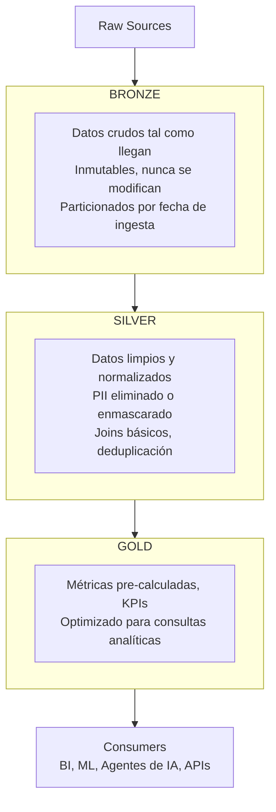
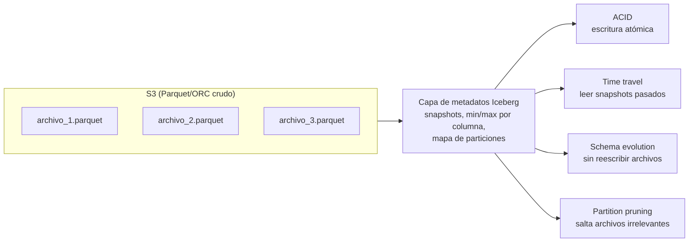
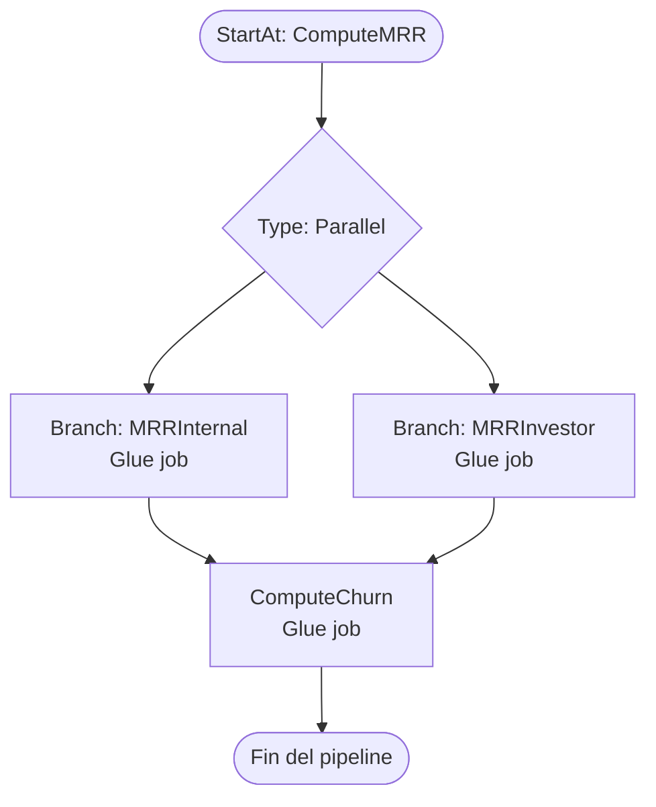
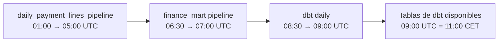
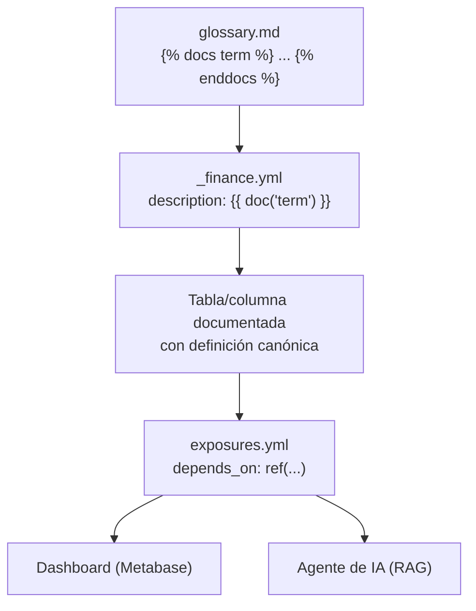
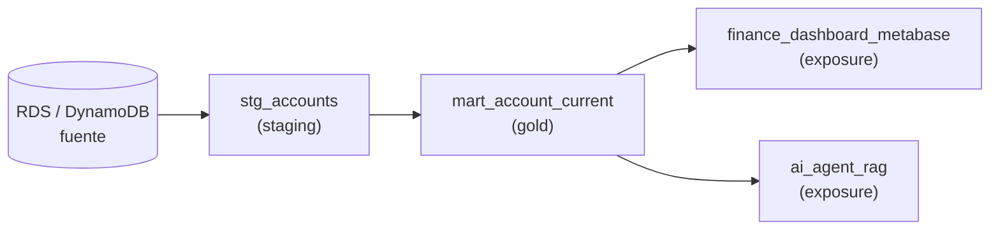
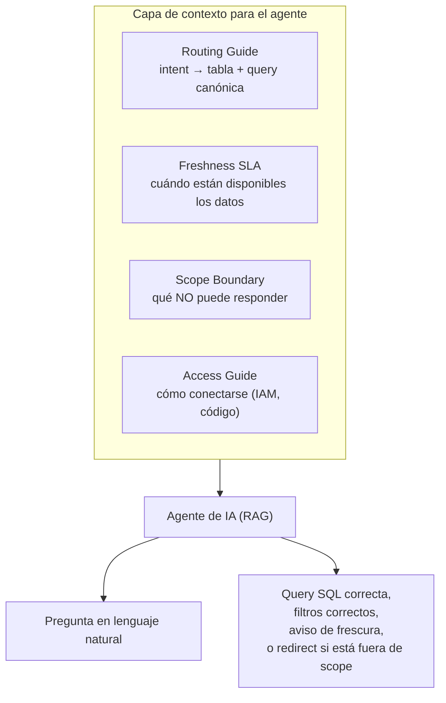
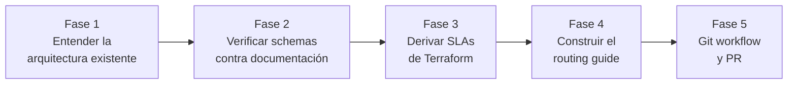
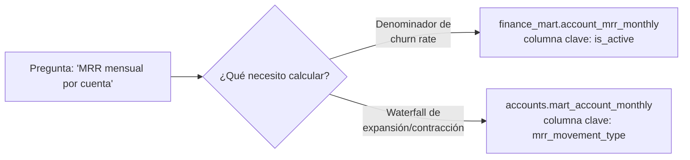

# De Data Quality a Semantic Layer para Agentes de IA
## Guía Completa para Data Engineers

> Este documento recorre el camino completo desde los fundamentos de un Modern Data Lakehouse hasta la construcción de una capa de documentación semántica para agentes de IA. Está pensado para Data Engineers que quieren alcanzar el nivel senior entendiendo no solo el "cómo" sino el "por qué" de cada decisión.

---

## Índice

- [Introducción](#introducción)
- [Parte I — Fundamentos que todo Senior DE debe dominar](#parte-i)
  - [Capítulo 1: Arquitectura Lakehouse Moderna](#cap1)
  - [Capítulo 2: Apache Iceberg — El formato de tabla moderno](#cap2)
  - [Capítulo 3: AWS Glue Data Catalog y Athena](#cap3)
  - [Capítulo 4: dbt — Transformación y documentación como código](#cap4)
  - [Capítulo 5: Orquestación de Pipelines](#cap5)
- [Parte II — Data Quality & Observability](#parte-ii)
  - [Capítulo 6: Las 6 dimensiones de calidad de datos](#cap6)
  - [Capítulo 7: Observability vs. Monitoring](#cap7)
  - [Capítulo 8: Freshness — La métrica que más se ignora](#cap8)
- [Parte III — El Semantic Layer](#parte-iii)
  - [Capítulo 9: Qué es y por qué importa](#cap9)
  - [Capítulo 10: dbt Glossary y Doc Blocks](#cap10)
  - [Capítulo 11: dbt Exposures — Linaje hasta el consumidor](#cap11)
- [Parte IV — Documentación para Agentes de IA](#parte-iv)
  - [Capítulo 12: El problema del agente sin contexto](#cap12)
  - [Capítulo 13: El Routing Guide — el GPS del agente](#cap13)
  - [Capítulo 14: El Freshness SLA](#cap14)
  - [Capítulo 15: El Scope Boundary](#cap15)
  - [Capítulo 16: Infrastructure Access Guide](#cap16)
- [Parte V — Walkthrough completo con comandos reales](#parte-v)
- [Glosario de términos](#glosario)

---

## Introducción

En 2024 y 2025, los equipos de datos se enfrentan a un nuevo tipo de consumidor: el agente de IA. A diferencia de un analista que puede hacer preguntas de seguimiento o un dashboard que consulta siempre la misma query fija, un agente de IA necesita entender la estructura de los datos, sus límites, su frescura y su semántica de negocio para poder responder preguntas en lenguaje natural.

Este documento nació de construir exactamente eso: una capa de documentación semántica para un agente RAG sobre el data warehouse de una plataforma SaaS B2B de WhatsApp. A lo largo del proceso aparecieron todos los problemas clásicos del data engineering en producción:

- Schemas que no coincidían con la documentación existente
- Tipos de columnas inesperados (`TIMESTAMP` donde se esperaba `DATE`)
- Dos tablas con nombres similares que resolvían preguntas distintas
- SLAs derivados de código Terraform, no de documentación explícita
- La necesidad de decirle al agente qué NO puede responder

El objetivo de esta guía es que entiendas cada uno de estos problemas, por qué ocurren, y cómo construir un sistema que los resuelva de forma robusta y mantenible.

---

## Parte I — Fundamentos que todo Senior DE debe dominar {#parte-i}

### Capítulo 1: Arquitectura Lakehouse Moderna {#cap1}

#### La Medallion Architecture (Bronze → Silver → Gold)

El patrón más extendido en Data Engineering moderno se llama **Medallion Architecture** o arquitectura de medallón. Divide el almacenamiento de datos en tres capas con responsabilidades distintas:

```
Raw Sources
    │
    ▼
┌─────────────────────────────────────────────────────────┐
│  BRONZE  │  Datos crudos tal como llegan de la fuente   │
│          │  Inmutables. Nunca se modifican.              │
│          │  Particionados por fecha de ingesta.          │
└─────────────────────────────────────────────────────────┘
    │
    ▼
┌─────────────────────────────────────────────────────────┐
│  SILVER  │  Datos limpios y normalizados                 │
│          │  PII eliminado o enmascarado.                 │
│          │  Joins básicos. Deduplicación.                │
└─────────────────────────────────────────────────────────┘
    │
    ▼
┌─────────────────────────────────────────────────────────┐
│  GOLD    │  Datos listos para el negocio                 │
│          │  Métricas pre-calculadas. KPIs.               │
│          │  Optimizados para consultas analíticas.       │
└─────────────────────────────────────────────────────────┘
    │
    ▼
Consumers (BI, ML, Agentes de IA, APIs)
```



**Bronze — La capa de aterrizaje**

El principio fundamental de Bronze es: *nunca pierdas datos crudos*. Cuando llegue un bug en la capa de transformación, querrás poder re-procesar desde Bronze. Cuando el negocio defina una nueva métrica que requiere datos históricos, Bronze es tu red de seguridad.

- Se escribe una vez (append-only o idempotente con replacement)
- Particionado por `ingestion_date` o `_loaded_at`
- Nunca se filtra ni se modifica la semántica original

**Silver — La capa de limpieza**

Silver aplica las reglas de negocio básicas: elimina duplicados, aplica los tipos correctos, une entidades relacionadas (ej: enriquecer un evento con el perfil del usuario), y elimina PII si aplica.

- Aquí viven las entidades de negocio: `accounts`, `subscriptions`, `payment_lines`
- El grain (granularidad) está definido y documentado
- Los tests de calidad de datos se aplican principalmente aquí

**Gold — La capa de negocio**

Gold contiene métricas pre-calculadas, KPIs y tablas optimizadas para analítica. Los datos de Bronze y Silver raramente tienen el formato que necesita un analista o un agente de IA — Gold hace ese trabajo de transformación pesada una vez, para que las queries sean baratas y rápidas.

- Tablas de hechos (fact tables): métricas históricas con grain por periodo
- Tablas de dimensión (dim tables): atributos actuales de entidades
- Marts: subconjuntos de Gold organizados por dominio de negocio

**Consejo de senior**: No caigas en la trampa de hacer Gold demasiado ancho. Una tabla con 80 columnas que "lo tiene todo" es un antipatrón. Diseña tablas con grain claro y propósito único.

---

### Capítulo 2: Apache Iceberg — El formato de tabla moderno {#cap2}

#### El problema que Iceberg resuelve

En el mundo del Data Lake tradicional, los datos se almacenaban en Parquet o ORC sobre S3. El problema: S3 no es una base de datos. No tiene ACID. No tiene control de concurrencia. Si un job falla a mitad de escritura, tienes archivos corruptos. Si dos jobs intentan escribir al mismo tiempo, tienes inconsistencias.

Apache Iceberg es un **formato de tabla abierto** que añade una capa de metadatos sobre los archivos de Parquet/ORC en S3, proporcionando:

**ACID Transactions**
```
Cada escritura a una tabla Iceberg es atómica:
  - O se completa en su totalidad
  - O no ocurre nada
No hay estados intermedios visibles para los lectores.
```

**Snapshot Isolation (Time Travel)**
```sql
-- Leer datos tal como estaban hace 3 días
SELECT * FROM finance_mart.fact_mrr_monthly_investor
  FOR SYSTEM_TIME AS OF TIMESTAMP '2026-08-09 00:00:00';

-- Ver el historial de snapshots
SELECT * FROM finance_mart."fact_mrr_monthly_investor$snapshots"
ORDER BY committed_at DESC;
```

**Schema Evolution sin reescritura**
```sql
-- Añadir una columna sin reescribir todos los archivos
ALTER TABLE operations_mart.churned_accounts_monthly
ADD COLUMN cancellation_date DATE;

-- Renombrar una columna
ALTER TABLE operations_mart.churned_accounts_monthly
RENAME COLUMN plan_type TO subscription_plan_type;
```

**Partition Pruning Inteligente**

Iceberg mantiene estadísticas de min/max por columna y por partición en sus metadatos. Cuando haces `WHERE month = '2026-08'`, Iceberg sabe exactamente qué archivos S3 contienen datos de ese mes — sin tener que escanear el resto. Esto reduce radicalmente el costo en Athena (que cobra por GB escaneado).

**Hidden Partitioning**
```sql
-- Partición por mes sin exponer al usuario la columna de partición
CREATE TABLE my_table (
  account_id INT,
  event_at TIMESTAMP,
  amount DOUBLE
)
USING ICEBERG
PARTITIONED BY (months(event_at));
-- Iceberg calcula automáticamente la partición del mes
-- sin que el usuario tenga que filtrar por una columna adicional
```



**¿Por qué no Parquet directamente?**

| Feature | Parquet + S3 | Apache Iceberg |
|---------|-------------|----------------|
| ACID | ❌ | ✅ |
| Time travel | ❌ | ✅ |
| Schema evolution | Limitada | ✅ Full |
| Partition pruning | Manual | ✅ Automático |
| Small file problem | Grave | Manejable (compaction) |
| Concurrent writes | Unsafe | ✅ Safe |

**Compaction — el mantenimiento obligatorio**

Iceberg tiende a crear muchos archivos pequeños con el tiempo, especialmente con escrituras incrementales. La compactación agrupa estos pequeños archivos en archivos más grandes, mejorando el rendimiento de lectura:

```sql
-- Compactar una tabla Iceberg en Athena/Spark
CALL glue_catalog.system.rewrite_data_files(
    table => 'operations_mart.churned_accounts_monthly',
    strategy => 'binpack',
    options => map(
        'target-file-size-bytes', '125829120',
        'min-file-size-bytes', '62914560'
    )
);
```

---

### Capítulo 3: AWS Glue Data Catalog y Athena {#cap3}

#### AWS Glue Data Catalog — El metastore centralizado

El Glue Data Catalog es el inventario central de todos los datos en tu lakehouse. Almacena:
- Qué **bases de datos** tienes
- Qué **tablas** hay en cada base de datos
- El **schema** (columnas y tipos) de cada tabla
- La **ubicación S3** de los datos
- Las **particiones** de cada tabla

Piénsalo como el catálogo de una biblioteca: no contiene los libros (los datos en S3), pero sabe exactamente dónde está cada libro, qué contiene y cómo está organizado.

**Comandos esenciales para verificar schemas:**

```bash
# Listar bases de datos (CORRECTO — no usar list-databases)
aws glue get-databases --region eu-north-1 \
  --query 'DatabaseList[].{Name:Name,Location:LocationUri}' \
  --output table

# Listar tablas en una base de datos
aws glue get-tables --region eu-north-1 \
  --database-name finance_mart \
  --query 'TableList[].{Name:Name,Location:StorageDescriptor.Location}' \
  --output table

# Obtener el schema completo de una tabla (CORRECTO — no usar --table-name)
aws glue get-table \
  --region eu-north-1 \
  --database-name finance_mart \
  --name account_mrr_monthly \
  --query 'Table.StorageDescriptor.Columns[].{Name:Name,Type:Type}' \
  --output table
```

**Lección aprendida en producción**: Siempre verifica el schema en el catálogo vivo antes de documentar o escribir queries. La documentación puede estar desactualizada. El catálogo no miente.

En nuestro caso, encontramos estas discrepancias entre documentación previa y el catálogo real:

| Tabla | Columna documentada | Columna real |
|-------|-------------------|--------------|
| `operations_mart.net_adoption_retention` | `nar_score` | `nar` |
| `operations_mart.net_adoption_retention` | `conversations_first_3m` | `conversations_3m` |
| `operations_mart.net_adoption_retention` | `activation_month` | `cohort_month` |
| `finance_mart.fact_credit_transactions_monthly` | `month` (DATE) | `month` (TIMESTAMP) |

Estas discrepancias habrían generado queries incorrectas o que fallaban. Verificar en el catálogo las evitó.

#### Amazon Athena — SQL serverless sobre S3

Athena es un motor de consultas serverless que permite ejecutar SQL estándar (dialecto Trino) directamente sobre los datos en S3, sin necesidad de cargarlos en ningún servidor.

**Modelo de precios**: pagas por GB de datos escaneados. Por eso, el partition pruning de Iceberg y los filtros selectivos `WHERE` son críticos económicamente.

**Workgroups — control de acceso y costos**

Los workgroups en Athena permiten:
- Establecer límites de escaneo por query (evitar queries accidentales que escaneen TB de datos)
- Definir el bucket S3 donde van los resultados
- Separar entornos (dev vs. prod)
- Aplicar políticas IAM granulares

```bash
# Verificar la configuración de un workgroup
aws athena get-work-group \
  --region eu-north-1 \
  --work-group spoki-iceberg \
  --query 'WorkGroup.Configuration'
```

**Dialecto Trino — las diferencias que importan**

Athena Engine Version 3 usa el dialecto SQL de Trino (antes llamado PrestoSQL). Las diferencias con SQL estándar más importantes:

```sql
-- Formatear fechas (NO usar TO_CHAR como en PostgreSQL)
SELECT DATE_FORMAT(event_at, '%Y-%m') AS month
FROM my_table;

-- División segura (evitar división por cero)
SELECT amount / NULLIF(total, 0) AS pct
FROM my_table;

-- Concatenar strings (NO usar +)
SELECT 'prefix_' || account_id AS key
FROM my_table;

-- Filtrar una columna TIMESTAMP por mes (NO usar =)
-- ❌ Incorrecto:
WHERE month = '2026-08'

-- ✅ Correcto cuando el tipo es TIMESTAMP:
WHERE DATE_FORMAT(month, '%Y-%m') = '2026-08'
```

---

### Capítulo 4: dbt — Transformación y documentación como código {#cap4}

#### Qué es dbt

dbt (data build tool) es una herramienta que permite escribir transformaciones de datos como modelos SQL con testing y documentación incorporados. Su premisa es simple: **los ingenieros de datos deben poder transformar datos usando solo SQL**, y el framework se encarga del rest.

```
dbt project/
├── models/
│   ├── staging/          # Silver layer: limpiar fuentes
│   │   ├── _sources.yml  # Declaración de tablas fuente
│   │   ├── _staging.yml  # Documentación y tests
│   │   └── stg_accounts.sql
│   ├── intermediate/     # Transformaciones intermedias
│   └── marts/            # Gold layer: KPIs y métricas
│       ├── finance/
│       │   ├── _finance.yml
│       │   └── fact_mrr_monthly.sql
│       └── accounts/
│           ├── _accounts.yml
│           └── mart_account_current.sql
├── tests/               # Tests personalizados en SQL
├── macros/              # Funciones reutilizables en Jinja
└── docs/
    └── glossary.md      # Definiciones de términos de negocio
```

**Modelos — SQL con materialización configurable**

Un modelo dbt es simplemente un archivo `.sql` con una SELECT:

```sql
-- models/marts/accounts/mart_account_current.sql
{{ config(materialized='table') }}

SELECT
    a.account_id,
    a.account_name,
    a.status,
    a.plan_slug,
    a.country_code,
    a.is_partner
FROM {{ ref('stg_accounts') }} a
WHERE a.status = 'Active'
```

El `{{ ref('stg_accounts') }}` es lo que construye el **linaje** automáticamente — dbt sabe que este modelo depende de `stg_accounts` y lo ejecuta en el orden correcto.

**Tests — la primera línea de defensa**

dbt ofrece tests genéricos que se declaran en YAML:

```yaml
# models/marts/accounts/_accounts.yml
models:
  - name: mart_account_current
    columns:
      - name: account_id
        tests:
          - not_null        # Ningún account_id puede ser NULL
          - unique          # Cada account_id aparece una sola vez
      - name: status
        tests:
          - accepted_values:
              values: ['Active', 'Trialing', 'Past Due', 'Cancelled']
      - name: plan_slug
        tests:
          - not_null
          - relationships:  # Integridad referencial
              to: ref('dim_plans')
              field: slug
```

**Comandos dbt más importantes:**

```bash
# Ejecutar todos los modelos
dbt run

# Ejecutar un modelo específico y sus dependencias
dbt run --select +mart_account_current

# Ejecutar los tests
dbt test

# Generar documentación HTML
dbt docs generate

# Servir documentación en localhost
dbt docs serve

# Ver linaje completo (requiere dbt docs generate primero)
# Se abre en browser en http://localhost:8080
```

---

### Capítulo 5: Orquestación de Pipelines {#cap5}

#### AWS Step Functions — Orquestación visual de jobs

Step Functions permite orquestar Glue jobs en grafos dirigidos acíclicos (DAGs). La ventaja sobre scripts bash o cron: el estado de cada step es visible, los errores se capturan por step, y puedes hacer retry automático o paralelo.

```json
// Ejemplo simplificado de un Step Functions definition
{
  "Comment": "Finance mart pipeline",
  "StartAt": "ComputeMRR",
  "States": {
    "ComputeMRR": {
      "Type": "Parallel",
      "Branches": [
        {"StartAt": "MRRInternal", "States": {"MRRInternal": {"Type": "Task", "Resource": "arn:aws:states:::glue:startJobRun.sync", "End": true}}},
        {"StartAt": "MRRInvestor", "States": {"MRRInvestor": {"Type": "Task", "Resource": "arn:aws:states:::glue:startJobRun.sync", "End": true}}}
      ],
      "Next": "ComputeChurn"
    },
    "ComputeChurn": {
      "Type": "Task",
      "Resource": "arn:aws:states:::glue:startJobRun.sync",
      "End": true
    }
  }
}
```

**Cómo leer un cron expression de EventBridge:**

```
cron(Minutes Hours Day-of-month Month Day-of-week Year)

cron(30 6 * * ? *)
      │  │  │  │  │  │
      │  │  │  │  │  └── Year: cualquier año
      │  │  │  │  └───── Day-of-week: ? (no aplica si se especifica Day-of-month)
      │  │  │  └──────── Month: * (cada mes)
      │  │  └─────────── Day-of-month: * (cada día)
      │  └────────────── Hours: 6 (06:00 UTC)
      └───────────────── Minutes: 30 → Resultado: 06:30 UTC

cron(0 1 * * ? *)  →  01:00 UTC (03:00 CET)
cron(30 8 * * ? *) →  08:30 UTC (10:30 CET)
```



**Lección clave**: Los schedules de Step Functions son tu fuente de verdad para los SLAs de frescura de datos. Aprende a leer Terraform para derivar cuándo están disponibles los datos.

---

## Parte II — Data Quality & Observability {#parte-ii}

### Capítulo 6: Las 6 dimensiones de calidad de datos {#cap6}

La calidad de datos no es una propiedad binaria (bueno/malo). Se mide en 6 dimensiones:

**1. Completeness (Completitud)**
¿Faltan valores donde no deberían?
```sql
-- Check: ¿Cuántas filas tienen account_id NULL?
SELECT
    COUNT(*) AS total_rows,
    COUNT(account_id) AS non_null_account_id,
    COUNT(*) - COUNT(account_id) AS null_count
FROM silver_data.accounts;
```

**2. Uniqueness (Unicidad)**
¿Hay duplicados donde el negocio requiere registros únicos?
```sql
-- Check: ¿Hay account_id duplicados en mart_account_current?
SELECT account_id, COUNT(*) AS cnt
FROM accounts.mart_account_current
GROUP BY account_id
HAVING COUNT(*) > 1;
```

**3. Consistency (Consistencia)**
¿Los datos son consistentes entre tablas relacionadas?
```sql
-- Check: ¿Hay churned accounts que aún aparecen como activos?
SELECT c.account_id
FROM operations_mart.churned_accounts_monthly c
JOIN accounts.mart_account_current a ON c.account_id = a.account_id
WHERE a.status = 'Active'
  AND c.month = '2026-08';
```

**4. Timeliness (Frescura)**
¿Los datos están actualizados dentro del SLA prometido?
```sql
-- Check: ¿Cuándo se actualizó por última vez esta tabla?
SELECT MAX(_loaded_at) AS last_updated
FROM operations_mart.churned_accounts_monthly;
```

**5. Validity (Validez)**
¿Los valores cumplen las reglas de negocio?
```sql
-- Check: ¿Hay MRR negativo donde no debería haberlo?
SELECT COUNT(*) AS invalid_rows
FROM finance_mart.fact_mrr_monthly_investor
WHERE mrr_amount < 0 AND NOT is_churn;
```

**6. Accuracy (Exactitud)**
¿Los datos reflejan la realidad? Esta es la más difícil de automatizar — a menudo requiere comparar contra una fuente externa (ej: comparar MRR en el warehouse con Stripe).

**Cómo implementar checks de calidad en dbt:**

```yaml
# En tu _finance.yml
models:
  - name: fact_mrr_monthly_investor
    tests:
      - dbt_utils.expression_is_true:
          expression: "mrr_amount >= 0 OR is_churn = true"
      - dbt_utils.recency:
          datepart: day
          field: _loaded_at
          interval: 2  # Los datos no pueden tener más de 2 días de antigüedad
    columns:
      - name: account_id
        tests:
          - not_null
      - name: month
        tests:
          - not_null
```

---

### Capítulo 7: Observability vs. Monitoring {#cap7}

Esta distinción es crucial y muchos Data Engineers la confunden:

**Monitoring** = saber que algo falló (alertas reactivas)
**Observability** = entender por qué falló (logs, trazas, métricas)

En el contexto de data pipelines:

| Monitoring | Observability |
|-----------|---------------|
| "El job de MRR falló" | "El job falló porque account_id tenía NULLs en 3 registros importados de Stripe a las 02:47" |
| "La tabla no se actualizó" | "La tabla no se actualizó porque el step anterior tardó 4h en lugar de 2h, violando el SLA" |
| Umbral: > 0 errores | Correlación: qué cambió en los datos de entrada |

**Cómo construir observability en un pipeline:**

```python
# En cada Glue job, emitir métricas estructuradas
import json

def emit_metric(job_name, table, metric_name, value, unit="Count"):
    print(json.dumps({
        "type": "metric",
        "job": job_name,
        "table": table,
        "metric": metric_name,
        "value": value,
        "unit": unit,
        "timestamp": datetime.now(timezone.utc).isoformat()
    }))

# Después de escribir:
row_count = df_result.count()  # Solo en validación, nunca en producción hot path
emit_metric("compute_mrr", "fact_mrr_monthly_investor", "rows_written", row_count)
emit_metric("compute_mrr", "fact_mrr_monthly_investor", "months_processed", distinct_months)
```

**Nota importante sobre `df.count()` en Spark**:

En producción, `df.count()` ejecuta un plan completo de Spark (full DAG scan). Úsalo solo en validaciones post-escritura, nunca en el hot path de transformación. Si necesitas el conteo como métrica de observabilidad, leerlo de los metadatos de Iceberg es más eficiente:

```python
# Leer el conteo de Iceberg metadata, NO de Spark count()
spark.sql(f"""
    SELECT summary['total-records'] AS total_records
    FROM glue_catalog.finance_mart."fact_mrr_monthly_investor$snapshots"
    ORDER BY committed_at DESC
    LIMIT 1
""")
```

---

### Capítulo 8: Freshness — La métrica que más se ignora {#cap8}

La frescura de datos es simple de definir: ¿cuánto tiempo hace desde que los datos reflejan el estado real del mundo?

Pero en la práctica es compleja porque:

1. Distintas tablas tienen distintos SLAs
2. El SLA depende de cuándo termina el pipeline, no de cuándo empieza
3. Hay dependencias entre pipelines (un job que depende de otro)
4. Los consumidores (analistas, agentes de IA) necesitan saber exactamente cuándo están disponibles los datos

**Cómo derivar SLAs de la infraestructura**:

El error más común es documentar SLAs sin verificar los schedules reales en la infraestructura. La fuente de verdad son los cron expressions en Terraform o CloudFormation:

```hcl
# dlh_infra/step_functions_iceberg_finance_mart.tf
resource "aws_cloudwatch_event_rule" "iceberg_finance_mart_schedule" {
  schedule_expression = "cron(30 6 * * ? *)"
  # → 06:30 UTC = 08:30 CET (invierno)
}
```

Pasos para derivar el SLA completo:
1. Leer el cron expression → cuándo **empieza** el pipeline
2. Estimar la duración del pipeline (ver CloudWatch logs históricos)
3. El SLA es el inicio + duración + buffer de seguridad

```
Finance mart pipeline:
  Start:     06:30 UTC
  Duration:  ~25 min (histórico)
  Buffer:    5 min
  SLA:       07:00 UTC (09:00 CET)
```

**La cadena de dependencias**:

Muchos pipelines son secuenciales: el pipeline B depende de que termine el pipeline A. El SLA del pipeline B siempre incluye el SLA del pipeline A:

```
01:00 UTC  daily_payment_lines_pipeline empieza
05:00 UTC  daily_payment_lines_pipeline termina (SLA)
06:30 UTC  finance_mart pipeline empieza (depende del anterior)
07:00 UTC  finance_mart pipeline termina (SLA)
08:30 UTC  dbt daily empieza (depende del anterior)
09:00 UTC  dbt daily termina (SLA)

→ Las tablas que genera dbt no están disponibles hasta las 09:00 UTC (11:00 CET)
```



Este descubrimiento fue crítico en nuestro proyecto: el equipo asumía que los datos de dbt estaban disponibles a las 09:00 CET, cuando en realidad el pipeline de dbt ni siquiera empezaba hasta las 10:30 CET.

---

## Parte III — El Semantic Layer {#parte-iii}

### Capítulo 9: Qué es y por qué importa {#cap9}

Un **Semantic Layer** es una capa de abstracción entre los datos crudos y los consumidores, que traduce el lenguaje técnico de las tablas al lenguaje del negocio.

Sin semantic layer:
- Cada analista interpreta `is_churn` a su manera
- "MRR" puede significar cosas distintas para Finance y para el equipo de Sales
- Cuando un campo cambia de nombre en la base de datos, todos los dashboards se rompen
- Un agente de IA no sabe si debe incluir partners en su consulta

Con semantic layer:
- `MRR` tiene una definición canónica que todos comparten
- `is_churn` está documentado con su significado exacto y sus implicaciones
- Los consumidores usan referencias simbólicas, no nombres de columna directos
- El agente de IA tiene el contexto necesario para responder correctamente

**Las tres capas de un semantic layer con dbt:**

```
1. Definiciones (glossary.md)
   → Qué significa cada término de negocio

2. Referencias ({{ doc('term') }} en .yml)
   → Conectar términos a columnas específicas

3. Exposures (exposures.yml)
   → Qué consume cada tabla (linaje hasta el consumidor)
```



---

### Capítulo 10: dbt Glossary y Doc Blocks {#cap10}

#### El patrón `` / `{{ doc() }}`

dbt permite escribir definiciones de términos en archivos Markdown y referenciarlos desde cualquier tabla o columna en los YAML:

**Paso 1: Escribir el glosario**

```markdown
<!-- models/docs/glossary.md -->


Monthly Recurring Revenue: la suma del revenue mensual recurrente confirmado,
excluyendo créditos y one-time payments.

**Cálculo**: SUM(mrr_amount) WHERE NOT is_churn

Fuente: `finance_mart.mrr_monthly_investor_split_v`



Flag sintética introducida por el pipeline de MRR para representar la última
observación de una cuenta que cancela.

Cuando `is_churn = true`:
- `mrr_amount = 0`
- `previous_mrr_amount` = el MRR real del último periodo activo

**CRÍTICO**: Siempre excluir filas `is_churn = true` al sumar MRR.

```

**Paso 2: Referenciar en YAML**

```yaml
# models/marts/finance/_finance.yml
models:
  - name: mrr_monthly_investor_split_v
    description: "{{ doc('mrr') }}"
    columns:
      - name: is_churn
        description: "{{ doc('is_churn') }}"
      - name: mrr_amount
        description: "{{ doc('mrr_amount') }}"
```

Ventajas:
- Si cambias la definición en `glossary.md`, se actualiza en todas las tablas que la referencian
- `dbt docs generate` produce documentación HTML navegable con linaje visual
- El glosario es consultable programáticamente (ideal para el agente de IA)

---

### Capítulo 11: dbt Exposures — Linaje hasta el consumidor {#cap11}

Los **Exposures** en dbt documentan quién usa tus datos: dashboards, APIs, herramientas de BI, agentes de IA. Sin exposures, el linaje de dbt termina en el modelo final — no sabes qué consumidores dependen de ese modelo.

```yaml
# models/exposures.yml
exposures:
  - name: finance_dashboard_metabase
    type: dashboard
    maturity: high
    url: https://metabase.spoki.com/dashboard/42
    description: >
      Dashboard principal de finanzas: MRR, ARR, churn, NRR.
      Consultado diariamente por el equipo de finanzas y dirección.
    depends_on:
      - ref('mart_account_current')
      - ref('fact_mrr_monthly_investor')
    owner:
      name: Finance Team
      email: finance@spoki.com

  - name: ai_agent_rag
    type: ml
    maturity: medium
    description: >
      Agente de IA con acceso RAG a las tablas de analytics para responder
      preguntas en lenguaje natural sobre KPIs de negocio.
    depends_on:
      - ref('mart_account_current')
      - ref('mart_account_monthly')
      - ref('churned_accounts_monthly')
    owner:
      name: AI Team
```

Con los exposures definidos, el grafo de linaje de dbt muestra el camino completo:

```
Fuente (RDS/DynamoDB)
    → stg_accounts (staging)
        → mart_account_current (gold)
            → finance_dashboard_metabase (exposure)
            → ai_agent_rag (exposure)
```



Esto es invaluable para impact analysis: "¿Si cambio la lógica de `mart_account_current`, qué dashboards y aplicaciones se ven afectadas?"

---

## Parte IV — Documentación para Agentes de IA {#parte-iv}

### Capítulo 12: El problema del agente sin contexto {#cap12}

Un agente de IA que puede consultar un data warehouse sin contexto es peligroso. El problema no es que el agente sea incompetente — es que no tiene la información necesaria para ser correcto. Los síntomas clásicos:

**Problema 1: Hallucinar tablas**
El agente inventa tablas que no existen porque el usuario pregunta "¿cuántos usuarios tiene la plataforma?" y el agente busca una tabla `users` que no existe en el esquema de analytics.

**Problema 2: Filtros incorrectos**
El agente suma MRR sin filtrar `is_churn = false`, sobreestimando el revenue. O no filtra partners, incluyendo entidades que el negocio excluye de sus KPIs.

**Problema 3: Tipos de datos incorrectos**
El agente intenta filtrar `WHERE month = '2026-08'` sobre una columna `month` de tipo TIMESTAMP — la query falla.

**Problema 4: Responder con datos desactualizados**
El agente responde "hoy el MRR es X" sin saber que los datos del warehouse son T-1 y que además la tabla de dbt no estaba disponible hasta las 11:00 CET.

**Problema 5: Mezclar tablas que responden a preguntas distintas**
Hay dos tablas relacionadas con MRR mensual por cuenta:
- `finance_mart.account_mrr_monthly` — grain: cuenta + mes + is_active
- `accounts.mart_account_monthly` — grain: cuenta + mes + mrr_movement_type

La primera tiene el flag `is_active` (útil para denominador de churn rate). La segunda tiene `mrr_movement_type` pre-calculado (útil para waterfall). Sin contexto, el agente puede usar la equivocada.

La solución a todos estos problemas es lo que construimos: tres documentos que juntos forman una capa de contexto para el agente.



---

### Capítulo 13: El Routing Guide — el GPS del agente {#cap13}

El Routing Guide es un mapa que relaciona **intents** (preguntas del negocio) con las **tablas correctas** y los **patterns SQL canónicos** para responderlas.

**Estructura de un intent:**

```yaml
# docs/agent_routing.yml
routing:
  churn_analysis:
    description: >
      Cuentas que cancelaron su suscripción, tasa de logo churn,
      MRR churn rate, atributos de las cuentas churned.
    primary_table: operations_mart.churned_accounts_monthly
    grain: account_id + month
    key_columns:
      - month          # VARCHAR 'YYYY-MM' — partition key
      - account_id
      - previous_mrr   # MRR en el mes ANTERIOR al churn
      - is_partner     # Excluir de KPIs de negocio
    gotchas:
      - "previous_mrr es el MRR del mes ANTES del churn, no el MRR del mes de churn"
      - "Los meses históricos (> 2 meses atrás) se reconcilian solo los domingos"
    canonical_queries:
      - label: "Logo churn rate"
        sql: |
          WITH churned AS (
              SELECT COUNT(DISTINCT account_id) AS churned_count
              FROM operations_mart.churned_accounts_monthly
              WHERE month = '2026-08' AND NOT is_partner
          ),
          active_prior AS (
              SELECT COUNT(DISTINCT account_id) AS active_count
              FROM finance_mart.account_mrr_monthly
              WHERE month = '2026-07'
                AND is_active = true AND NOT is_partner
          )
          SELECT
              churned_count,
              active_count,
              ROUND(100.0 * churned_count / NULLIF(active_count, 0), 2)
                  AS logo_churn_rate_pct
          FROM churned CROSS JOIN active_prior;
```

**Por qué las queries canónicas son esenciales:**

Sin queries canónicas, el agente puede generar queries técnicamente válidas pero semánticamente incorrectas. Por ejemplo, calcular el MRR churn rate usando el total de cuentas en lugar de solo las cuentas activas en el mes anterior — una diferencia sutil que produce un número completamente distinto.

Las queries canónicas documentan la intención y la implementación correcta. Son también tests implícitos: si el schema cambia y la query canónica falla, sabes inmediatamente qué documentar actualizar.

**Verificar siempre el schema contra el catálogo vivo:**

El proceso que seguimos para construir el routing guide:

1. Documentar el intent y la tabla primaria
2. Verificar en Glue que las columnas existen y tienen el tipo correcto
3. Ejecutar la query canónica en Athena para verificar que no falla
4. Documentar los gotchas descubiertos

```bash
# Paso 2: verificar schema en Glue
aws glue get-table \
  --region eu-north-1 \
  --database-name operations_mart \
  --name net_adoption_retention \
  --query 'Table.StorageDescriptor.Columns[].{Name:Name,Type:Type}' \
  --output table

# Resultado real vs documentación previa:
# nar_score → nar (nombre incorrecto en docs)
# conversations_first_3m → conversations_3m (nombre incorrecto)
# activation_month → no existe (columna combinada en cohort_month + activation_date)
```

---

### Capítulo 14: El Freshness SLA {#cap14}

El Freshness SLA responde a la pregunta: **"¿Cuándo puede el agente decir que los datos están disponibles?"**

La estructura de cada entrada:

```yaml
# docs/freshness_sla.yml
table_freshness:
  accounts.mart_account_current:
    routing_intent: account_status
    data_as_of: T-1 (yesterday)
    available_by: "09:00 UTC (11:00 CET)"
    staleness_window: "~24 hours"
    pipeline: dbt daily (layer_3)
    agent_script: >
      "Account data is current as of yesterday. It is refreshed daily and
       available from approximately 11:00 CET onward. If queried before
       11:00 CET, the data may reflect the day before yesterday."
```

El campo `agent_script` es el texto que el agente debe incluir en su respuesta para comunicar la frescura al usuario. Esto evita que el agente responda "el MRR de hoy es X" cuando en realidad los datos son de ayer.

**Tip**: Documenta también el pipeline chain (la cadena de dependencias). Si el pipeline A falla, los datos de las tablas que dependen del pipeline B también estarán desactualizados, aunque el pipeline B no haya fallado.

---

### Capítulo 15: El Scope Boundary {#cap15}

El Scope Boundary es tan importante como el Routing Guide: define qué **no puede** responder el agente.

Sin un scope boundary explícito, el agente intentará responder todas las preguntas — y cuando no encuentre los datos, inventará algo o dará una respuesta incorrecta. Es mejor que el agente diga "eso no está disponible en el warehouse, pregunta al equipo de ingeniería" que que responda con datos incorrectos.

**Estructura de un límite:**

```yaml
# docs/agent_scope.yml
cannot_answer:
  - category: individual_message_content
    description: >
      Contenido de mensajes WhatsApp individuales. Está en DynamoDB,
      no en el warehouse. Solo se agregan conteos y volúmenes.
    redirect: "Contacta al equipo de ingeniería para acceso directo a DynamoDB."
    examples:
      - "Muéstrame el último mensaje enviado al contacto X"
      - "Encuentra mensajes que contengan la palabra 'cancelación'"

  - category: real_time_data
    description: >
      Todas las tablas del warehouse son T-1. No hay datos intradiarios.
    redirect: >
      Para métricas en tiempo real, usa los dashboards de producto o
      consulta la base de datos operacional directamente.
```

**Las preguntas ambiguas son igual de importantes:**

```yaml
clarify_before_querying:
  - pattern: "'today' or 'current'"
    action: >
      Confirmar si el usuario quiere datos T-1 (el refresh más reciente)
      o verdaderamente datos en tiempo real (no disponibles).

  - pattern: "'all accounts' or 'every account'"
    action: >
      Clarificar si incluir cuentas partner (is_partner = true).
      La mayoría de KPIs excluye partners.
```

---

### Capítulo 16: Infrastructure Access Guide {#cap16}

El Access Guide es el documento de handoff para el equipo que implementa el agente. Debe contener todo lo necesario para conectarse al warehouse sin fricción:

1. **Coordenadas AWS**: región, catalog ID, workgroup, bucket
2. **IAM policy**: los permisos mínimos necesarios (principio de menor privilegio)
3. **Código de ejemplo**: cómo ejecutar una query en Python
4. **Notas de dialecto SQL**: las diferencias de Trino que causarán errores
5. **Tabla de frescura resumida**: cuándo están disponibles los datos

**Principio de menor privilegio en IAM:**

```json
{
  "Statement": [
    {
      "Effect": "Allow",
      "Action": ["athena:StartQueryExecution", "athena:GetQueryResults"],
      "Resource": "arn:aws:athena:eu-north-1:392279754652:workgroup/spoki-iceberg"
    },
    {
      "Effect": "Allow",
      "Action": ["glue:GetTable", "glue:GetTables"],
      "Resource": [
        "arn:aws:glue:eu-north-1:392279754652:database/finance_mart",
        "arn:aws:glue:eu-north-1:392279754652:table/finance_mart/*"
      ]
    },
    {
      "Effect": "Allow",
      "Action": ["s3:GetObject"],
      "Resource": "arn:aws:s3:::spoki-data-platform-core-prd/*"
    }
  ]
}
```

Nota que el IAM solo da acceso a las **4 bases de datos aprobadas**, no a todo el catálogo. El agente no puede ver, ni por error, datos de las capas silver o bronze.

---

## Parte V — Walkthrough completo con comandos reales {#parte-v}

Esta sección documenta el proceso real que seguimos, con los comandos exactos, los errores encontrados, las correcciones y los aprendizajes.



### Fase 1: Entender la arquitectura existente

**Objetivo**: Antes de documentar, entender qué existe.

```bash
# 1. Listar todas las bases de datos del catálogo
aws glue get-databases \
  --region eu-north-1 \
  --query 'DatabaseList[].{Name:Name}' \
  --output table

# 2. Para cada base de datos relevante, ver qué tablas hay
aws glue get-tables \
  --region eu-north-1 \
  --database-name finance_mart \
  --query 'TableList[].{Name:Name,Location:StorageDescriptor.Location}' \
  --output table

# 3. Para una tabla específica, ver el schema completo
aws glue get-table \
  --region eu-north-1 \
  --database-name finance_mart \
  --name mrr_monthly_investor_split_v \
  --query 'Table.StorageDescriptor.Columns[].{Name:Name,Type:Type}' \
  --output table
```

**Error común**: El comando `aws glue list-databases` no existe — es `aws glue get-databases`. Del mismo modo, `--table-name` no es un flag válido — el flag correcto es `--name`.

**Aprendizaje**: Verificar la CLI reference antes de asumir los nombres de parámetros. Los comandos de Glue son menos intuitivos que los de S3 o EC2.

### Fase 2: Verificar schemas contra documentación

**Objetivo**: Confirmar que cada columna documentada existe con el tipo correcto.

```bash
# Verificar la tabla net_adoption_retention
aws glue get-table \
  --region eu-north-1 \
  --database-name operations_mart \
  --name net_adoption_retention \
  --query 'Table.StorageDescriptor.Columns[].{Name:Name,Type:Type}' \
  --output table
```

**Discrepancias encontradas y corregidas**:

| Lo que había documentado | Lo que el catálogo decía | Acción |
|--------------------------|--------------------------|--------|
| `nar_score` | `nar` | Corregir en routing guide |
| `conversations_first_3m` | `conversations_3m` | Corregir |
| `activation_month` (VARCHAR) | `cohort_month` (VARCHAR) + `activation_date` (DATE) | Separar en dos columnas |
| `month` (DATE) en credit transactions | `month` (TIMESTAMP) | Corregir y añadir nota de filtro |

Para el caso del TIMESTAMP, la corrección es crítica:
```sql
-- ❌ Falla silenciosamente (retorna 0 filas en Athena)
WHERE month = '2026-08'

-- ✅ Correcto para columna TIMESTAMP
WHERE DATE_FORMAT(month, '%Y-%m') = '2026-08'
```

### Fase 3: Derivar SLAs de Terraform

**Objetivo**: Entender cuándo están disponibles los datos sin depender de documentación informal.

```bash
# Buscar todos los cron expressions en el proyecto de infra
grep -r "cron(" /Users/morad/Projects/spoki-data/dlh_infra/ \
  | grep -v ".terraform"

# Resultado:
# step_functions.tf: cron(0 1 * * ? *)           → 01:00 UTC
# step_functions_iceberg_finance_mart.tf: cron(30 6 * * ? *) → 06:30 UTC
# codebuild.tf (dbt daily): cron(30 8 * * ? *)    → 08:30 UTC
```

Para entender la cadena de dependencias, leer el Step Functions definition:

```hcl
# step_functions_iceberg_finance_mart.tf
# Flow comment es la guía:
# Parallel(MRR + MRR_split) → Parallel(NRR + Churn + ChurnedAccountsCurrentMonth)
```

**Aprendizaje**: El código de infraestructura es documentación. Si el equipo mantiene buenos comentarios en Terraform (como el `# Flow:` en el Step Functions definition), es más fiable que cualquier wiki.

### Fase 4: Construir el routing guide

**Objetivo**: Documentar 10 intents con queries canónicas verificadas.

El proceso por intent:
1. Identificar la pregunta de negocio que responde
2. Determinar la tabla primaria en Glue
3. Verificar el schema de esa tabla
4. Escribir la query canónica
5. Ejecutar la query en Athena para verificar que no falla
6. Documentar los gotchas encontrados

**Ejemplo de gotcha importante**: Dos tablas para "MRR mensual por cuenta"

```
finance_mart.account_mrr_monthly
  → Grain: account_id + month
  → Columna clave: is_active (boolean)
  → Uso: denominator para logo churn rate
  → "¿Estaba activa esta cuenta este mes?"

accounts.mart_account_monthly
  → Grain: account_id + month
  → Columna clave: mrr_movement_type (New/Expansion/Contraction/Churn/Reactivation/Flat)
  → Uso: MRR waterfall, expansión/contracción sin self-join
  → "¿Qué tipo de movimiento tuvo esta cuenta este mes?"
```



Sin este contexto, un agente (o un analista) podría usar la tabla equivocada para una pregunta específica.

### Fase 5: Git workflow en rama nueva desde master

**Objetivo**: Commitear los 8 ficheros de documentación en una rama limpia sin mezclar con trabajo en curso de otras ramas.

```bash
# Verificar en qué rama están actualmente los ficheros
git status
git branch

# Crear rama nueva desde origin/master (no desde la rama actual)
git checkout origin/master -b feat/ai-agent-docs

# Si tienes cambios en otra rama que quieres aplicar, usar patch:
git diff HEAD -- docs/glossary.md > /tmp/glossary.patch
git apply /tmp/glossary.patch

# Añadir solo los ficheros relevantes (no git add -A)
git add docs/agent_routing.yml
git add docs/freshness_sla.yml
git add docs/agent_scope.yml
git add docs/infra_access.md
git add dbt/spoki_analytics/models/docs/glossary.md
git add dbt/spoki_analytics/models/exposures.yml

# Verificar qué se va a commitear
git status
git diff --staged

# Commitear con mensaje descriptivo
git commit -m "feat(docs): AI agent documentation layer

- agent_routing.yml: 10 intents con queries canónicas verificadas en Glue
- freshness_sla.yml: SLA por tabla derivado de schedules Terraform
- agent_scope.yml: límites técnicos y de negocio del agente
- infra_access.md: handoff para el equipo de IA

Co-Authored-By: Claude Sonnet 4.6 <noreply@anthropic.com>"

# Abrir PR
gh pr create \
  --title "feat(docs): AI agent documentation layer" \
  --base master \
  --body "..."
```

**Consejo de senior**: Nunca uses `git add -A` o `git add .` cuando trabajas con múltiples features en paralelo. Siempre añade ficheros específicos para tener control completo de qué va a cada commit.

---

## Glosario de términos {#glosario}

**Apache Iceberg**: Formato de tabla abierto para Data Lakes que añade ACID transactions, time travel, schema evolution y partition pruning sobre archivos Parquet/ORC en S3.

**ARR (Annual Recurring Revenue)**: Ingresos recurrentes anualizados. `ARR = MRR * 12`.

**Athena Workgroup**: Unidad de configuración en Amazon Athena que define límites de escaneo, bucket de resultados y políticas IAM. Cada entorno o caso de uso debe tener su propio workgroup.

**Bronze Layer**: Capa de aterrizaje de datos crudos, inmutables y sin transformación. Particionados por fecha de ingesta.

**Compaction (Iceberg)**: Operación de mantenimiento que agrupa los archivos Parquet pequeños en archivos más grandes, mejorando el rendimiento de lectura. Se ejecuta periódicamente con `CALL system.rewrite_data_files()`.

**dbt (data build tool)**: Framework de transformación de datos SQL con documentación, tests y linaje incorporados. Los modelos son archivos `.sql` con una SELECT; las dependencias se definen con `{{ ref('model_name') }}`.

**dbt Exposure**: Declaración en YAML que documenta quién consume las tablas de dbt (dashboards, APIs, agentes). Completa el grafo de linaje más allá del warehouse.

**dbt Doc Block**: Definición de un término de negocio en un archivo `.md` usando la sintaxis ``. Referenciado en YAML con `{{ doc('term_name') }}`.

**Freshness SLA**: Acuerdo de nivel de servicio que define cuándo estarán disponibles los datos después de cada refresh del pipeline. Derivado de los schedules de la infraestructura.

**Gold Layer**: Capa de datos listos para consumo analítico: métricas pre-calculadas, KPIs, fact tables y dimension tables.

**Grain (Granularidad)**: El nivel de detalle de una tabla. Por ejemplo: "una fila por account_id y mes" o "una fila por transacción". El grain debe estar documentado explícitamente.

**Glue Data Catalog**: Metastore centralizado de AWS que almacena la definición de bases de datos, tablas, schemas y ubicaciones S3 del Data Lakehouse.

**Intent (Routing Guide)**: Una pregunta de negocio categorizada, como "¿cuánto MRR tenemos este mes?" o "¿qué cuentas churnearon?". El routing guide mapea intents a tablas y queries canónicas.

**is_churn**: Flag sintética en las tablas de MRR de Spoki. Cuando `true`, la fila representa la última observación de una cuenta que cancela: `mrr_amount = 0`, `previous_mrr_amount` = último MRR real. Siempre filtrar con `WHERE NOT is_churn` al sumar MRR.

**Kimball Methodology**: Metodología de diseño de Data Warehouses de Ralph Kimball, basada en tablas de hechos (métricas) y tablas de dimensión (atributos). Favorece la denormalización para optimizar consultas analíticas.

**Lakehouse**: Arquitectura que combina la flexibilidad de un Data Lake (almacenamiento barato en S3) con las capacidades de un Data Warehouse (ACID, schemas, SQL). Apache Iceberg es la tecnología que habilita esta combinación.

**Medallion Architecture**: La implementación más común del Lakehouse con tres capas: Bronze (raw), Silver (clean), Gold (business-ready).

**MRR (Monthly Recurring Revenue)**: Ingresos mensuales recurrentes. En Spoki: subscription fees sin créditos y sin partners.

**NRR (Net Revenue Retention)**: Porcentaje de revenue retenido de los clientes existentes después de un periodo. `NRR = (MRR inicio + expansión - contracción - churn) / MRR inicio * 100`.

**Observability**: La capacidad de entender por qué un sistema se comporta de cierta manera a partir de sus salidas (logs, métricas, trazas). Distinto de monitoring, que solo detecta si algo falló.

**Partition Pruning**: Optimización de Iceberg que permite saltar archivos S3 completos basándose en las estadísticas de partición, sin escanearlos. Reduce el costo de las queries en Athena.

**RAG (Retrieval-Augmented Generation)**: Técnica de IA que aumenta las capacidades de un LLM con documentos o datos recuperados dinámicamente, permitiéndole responder preguntas sobre información que no estaba en su entrenamiento.

**Routing Guide**: Documento que mapea preguntas de negocio (intents) con las tablas del warehouse y los patterns SQL canónicos para responderlas. Es el "GPS" del agente de IA.

**Schema Evolution**: Capacidad de Iceberg de añadir, renombrar o eliminar columnas sin reescribir los datos existentes ni romper los lectores que usan el schema anterior.

**Scope Boundary**: Documento que define explícitamente qué preguntas NO puede responder el agente, con la razón y el redirect apropiado. Tan importante como el Routing Guide.

**Semantic Layer**: Capa de abstracción entre los datos crudos y los consumidores que traduce el lenguaje técnico de las tablas al lenguaje del negocio, con definiciones canónicas de términos.

**Silver Layer**: Capa de datos limpios y normalizados. PII eliminado o enmascarado. Entidades de negocio definidas con grain claro.

**Snapshot (Iceberg)**: Punto en el tiempo del estado de una tabla Iceberg. Permite time travel y rollback. La compactación elimina snapshots antiguos para liberar espacio en S3.

**T-1**: "Tiempo menos 1 día". Los datos del warehouse son T-1 porque se actualizan diariamente con los datos del día anterior. No hay datos intradiarios en el warehouse.

**Time Travel**: Capacidad de Iceberg de leer el estado de una tabla en un punto anterior en el tiempo, usando sus snapshots. Útil para debugging y reconciliación histórica.

**Trino SQL**: Dialecto SQL distribuido usado por Amazon Athena Engine v3. Diferencias clave respecto a SQL estándar: `DATE_FORMAT()` en lugar de `TO_CHAR()`, `||` para concatenación, sin soporte para algunas funciones de ventana avanzadas de PostgreSQL.

**Workgroup (Athena)**: Ver Athena Workgroup.

---

*Este documento se actualizará conforme evolucione la arquitectura del data platform.*

**Autor**: Equipo de Data Platform, Spoki
**Fecha**: 2026-08-12
**Versión**: 1.0
