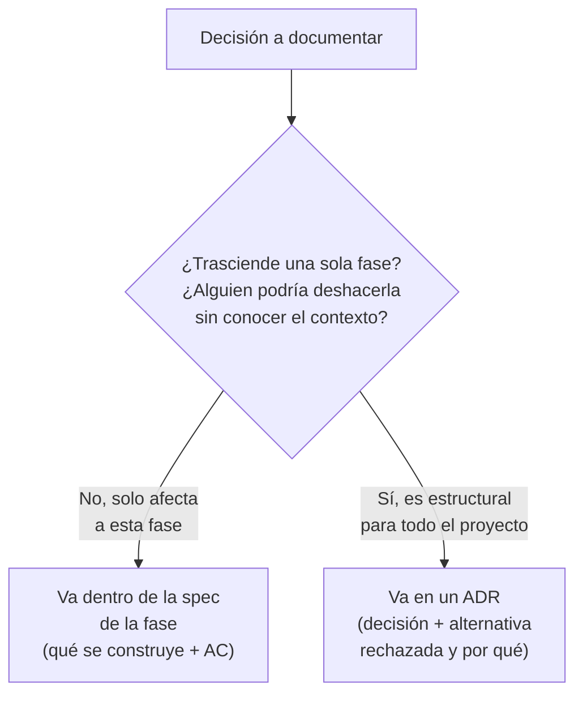
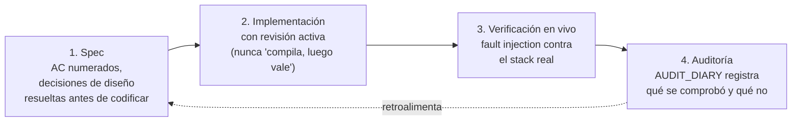
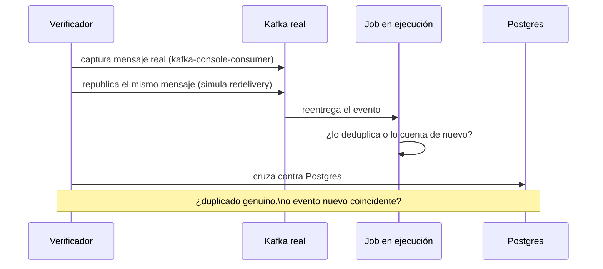
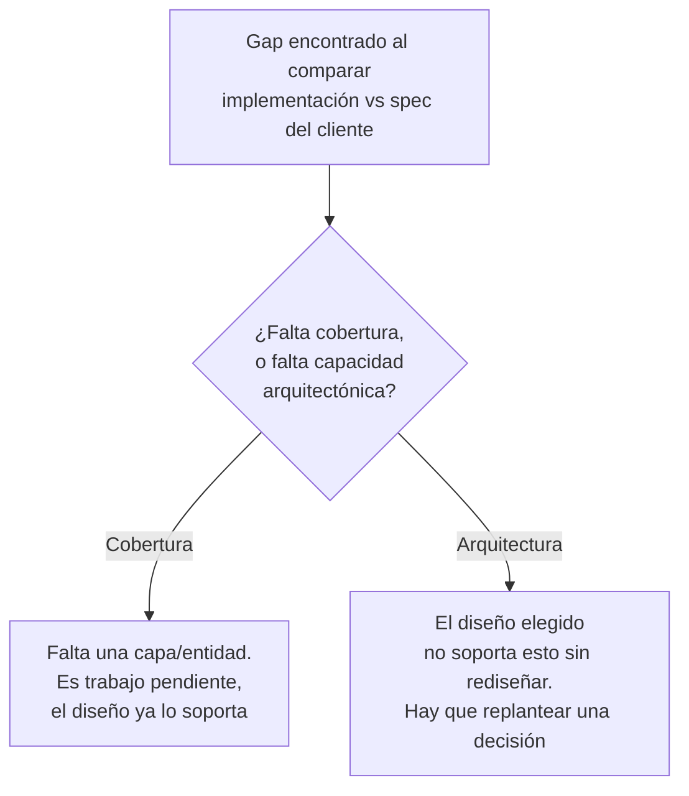

# Spec-driven development, de verdad: qué es, qué no es, y dónde se rompe

Igual que el fichero de streaming, esto no es un índice de lo que ya escribiste. Es la síntesis de
cómo se ha hecho spec-driven development en este proyecto concreto, con los sitios donde el método se
tensiona de verdad, no la versión de manual que suena bien en una entrevista pero que nadie ha puesto
nunca a prueba contra un bug real.

## La confusión de partida: una spec no es un test, y un ADR no es una spec

Dos formatos que se parecen en la superficie (ambos son un `.md` con una decisión dentro) y que
cumplen funciones distintas; si los mezclas pierdes la utilidad de los dos.

Una **spec de fase** (`specs/phases/NN-nombre/spec.md`) responde a "¿qué se va a construir, y cómo
sabré que está bien construido?". Tiene que sobrevivir sin ti delante: alguien que no ha hablado
contigo tiene que poder leerla y saber exactamente qué comportamiento se espera, en qué casos límite,
y qué evidencia demostraría que funciona. Si tu criterio de aceptación es "el pipeline debe
funcionar correctamente", no es un criterio, es una esperanza sin forma de verificarla.

Un **ADR** (Architecture Decision Record) responde a una pregunta distinta y mucho más estrecha:
"¿por qué elegimos X en vez de la alternativa obvia Y, en este punto concreto?". No describe todo un
sistema, describe una bifurcación puntual, y lo importante no es tanto lo que se eligió sino **lo que
se rechazó y por qué**, documentado con la misma seriedad que la opción ganadora. `ADR-0002` de este
proyecto no dice solo "usamos PyFlink", explica por qué no Java Flink: un solo lenguaje (Python) en
todo el stack, a costa de aceptar limitaciones reales de la API de PyFlink frente a la de Java.
`ADR-0008` no dice solo "hay un bridge Kinesis a Kafka", explica que Flink 2.x eliminó la interfaz
`SourceFunction` legada de la que dependía `FlinkKinesisConsumer`, así que la alternativa "usar el
conector nativo de Kinesis" ni siquiera estaba disponible; el bridge no es una preferencia de diseño,
es la única opción que quedó en pie tras esa versión concreta del motor.

La prueba de que has entendido la diferencia: si te preguntan "¿cuándo escribes un ADR en vez de
meter la decisión dentro de la spec de la fase?", la respuesta correcta no es "cuando es importante"
(todo lo que va en una spec es importante), es "cuando la decisión trasciende una sola fase y alguien
en el futuro podría razonablemente proponer deshacerla sin conocer el contexto que ya la descartó".
Una decisión de qué campos lleva un evento de una fase concreta va en la spec. Una decisión de qué
motor de streaming usar en todo el proyecto va en un ADR.

## Cómo cambió el formato de spec con el tiempo, y qué problema resolvió cada cambio

Comparar la spec de la Fase 1 (mock app más base de datos) con la de la Fase 26 (Market Pulse Job) no
es solo ver que la segunda es más larga. Cada cosa que se añadió respondió a un dolor concreto de
fases anteriores, no a "vamos a hacerlo más completo porque sí":

- **Criterios de aceptación numerados y verificables (AC-01, AC-02...)**, en vez de una descripción de
  comportamiento esperado en prosa. El motivo: una prosa general se puede interpretar como "cumplida"
  de formas distintas por dos personas distintas (o por la misma persona en dos momentos distintos).
  Un AC numerado y con una condición concreta ("un evento tardío dentro de 60s reemite la ventana ya
  cerrada; fuera de ese margen, va a un side output logueado, nunca se descarta en silencio") no deja
  ese margen de interpretación, y de hecho es exactamente lo que le permitió a este proyecto detectar
  que AC-04 y AC-05 de la Fase 26 estaban **completamente sin implementar**, semanas después de
  escrita la spec: al buscar en el código las palabras que el AC exigía (`allowed_lateness`,
  `side_output`, `OutputTag`) y no encontrar ninguna coincidencia, la ausencia fue innegable, no hubo
  forma de discutir si "en realidad sí estaba cumplido a medias".
- **Decisiones de diseño documentadas dentro de la propia spec**, con las alternativas descartadas y
  por qué, no solo la decisión final. Esto vino de fases donde una decisión se tomó, se implementó, y
  meses después alguien (a menudo el propio autor) se preguntó "¿por qué no hicimos esto de la otra
  forma, que parece más simple?" y tuvo que reconstruir el razonamiento de memoria, mal. Documentarlo
  en el momento es más barato que reconstruirlo después.
- **Diagramas del flujo de datos**, no solo texto. Un flujo con múltiples streams, ventanas y joins
  (como la Fase 26, con tres ventanas independientes compartiendo una fuente) es genuinamente más
  fácil de verificar visualmente, "¿esta flecha va donde creo que va?", que reconstruido frase a
  frase.

El patrón general: **el formato de spec no mejoró por estética, mejoró porque cada añadido cerró una
forma concreta de fallar que ya había ocurrido.** Si te preguntan cómo decidirías qué debe llevar una
spec en un proyecto nuevo, esa es la respuesta honesta, no una plantilla bajada de internet, sino una
que has visto fallar y corregido tú.

## El ciclo real de este proyecto: spec, implementación con revisión activa, verificación en vivo, auditoría

Aquí está el proceso completo, con la Fase 26 como caso real de principio a fin, porque es el único
que se verificó así de estricto en este proyecto:

Cada flecha es una pregunta distinta, y saltarse una no la reemplaza con la siguiente: pasar los
tests de la fase 2 no sustituye la verificación en vivo de la fase 3, y verificar en vivo sin
documentarlo en la fase 4 deja el conocimiento solo en la cabeza de quien lo hizo.

**1. La spec se escribe antes de tocar código**, con criterios de aceptación numerados y las
decisiones de ventaneo ya resueltas (qué se agrupa, cómo se combina, qué pasa con lo tarde; ver
`streaming-mastery.md`).

**2. La implementación se revisa activamente contra la spec, no se asume correcta porque compila.**
En este proyecto eso tomó la forma concreta de que el código se escribiera con errores deliberados
para forzar una lectura crítica línea a línea en vez de una lectura de confianza, pero el principio
generaliza más allá de esa técnica concreta: **nunca confundas "el test unitario pasa" con "cumple la
spec"**. Un ejemplo real: el off-by-one en el contador de cancelaciones (`cancelled_count + 1` en vez
de `cancelled_count`) no lo cogió ningún test, porque no existía un test dedicado al sink; lo cogió
una lectura humana del código. Otro ejemplo, el inverso: el error de signo en la fórmula de profit
(`+ total_cost_eur` en vez de `- total_cost_eur`) sí lo cogió un test, porque ese test comparaba
contra un número calculado a mano de antemano, no contra "lo que el código ya produce".

**3. La verificación en vivo es un paso aparte de los tests, y responde una pregunta distinta.** Un
test unitario responde "¿esta función hace lo que su docstring dice, con estos inputs sintéticos?".
La verificación en vivo responde "¿el sistema completo, corriendo de verdad contra Kafka, Flink y
DynamoDB reales, produce el comportamiento que la spec promete, incluyendo bajo fallos reales?". La
técnica concreta usada aquí para simular reentrega: capturar un mensaje real de Kafka con
`kafka-console-consumer`, y republicarlo con `kafka-console-producer` para simular una redelivery, y
cruzar el resultado contra Postgres para distinguir si lo que veías era un duplicado genuino o
simplemente un evento nuevo que coincidía por casualidad. Esto encontró **tres bugs reales, no
sembrados**, que ningún test unitario había tocado: una variable de entorno de DynamoDB ausente en
`docker-compose.yml` (el job hablaba con AWS real con credenciales falsas en vez de con LocalStack),
un contenedor corriendo una imagen Docker obsoleta, y los dos criterios de aceptación (AC-04/AC-05)
completamente sin implementar pese a estar en la spec.

**4. La auditoría documenta qué se comprobó de verdad, con evidencia concreta, separada de lo que la
spec prometía.** `AUDIT_DIARY.md` no repite la spec, registra, fase a fase, qué se verificó
realmente, con qué comandos, con qué números observados, y qué queda explícitamente sin verificar y
por qué (en la Fase 26: AC-06, aislamiento de reinicio de job concurrente, no se pudo verificar porque
el TaskManager solo tiene 4 slots y ambos jobs juntos los superan; AC-11, fault injection de partición
inactiva, se razonó estructuralmente pero no se forzó de verdad). **Esto es la parte que más
distingue el spec-driven development real del decorativo: decir explícitamente qué no se comprobó, en
vez de dejarlo ambiguo o fingir que sí.**

*Pregúntate: ¿cómo verificas que una implementación cumple su spec, más allá de que los tests
unitarios pasen?* Tu respuesta real, con ejemplo: fault injection contra el stack real,
republicar mensajes de Kafka, cruzar contra la base de datos fuente, no "corrí pytest y no hubo
fallos". Y ten lista la distinción del punto 4: qué se dejó documentado como abierto y por qué, no
solo lo que se cerró.

## Auditar una spec que no escribiste tú: la lente del gap analysis

Hay una habilidad distinta y complementaria: no escribir una spec, sino comprobar si una
implementación ya existente cumple la spec de **otra persona** (en este proyecto, la spec de un
cliente real, BiLemon). El formato que funcionó aquí tiene tres piezas, y las tres importan:

1. **Un veredicto resumido en una frase**, antes de cualquier detalle: qué porcentaje del alcance
   está cubierto y en qué se parece de verdad la arquitectura a la pedida, no una lista de 40 puntos
   sin jerarquía.
2. **Una tabla punto por punto** con tres estados posibles, no dos: implementado, **parcial**, y no
   implementado. El estado "parcial" es el que más valor aporta y el que más gente se salta por
   pereza. Decir "cumplido" o "no cumplido" es fácil; decir con precisión *qué parte* de un requisito
   está cubierta y cuál no (por ejemplo: "la fórmula BER/MPR coincide exactamente, pero solo 3 de las
   5 bases contractuales del cliente existen") es lo que de verdad sirve para planificar el trabajo
   restante.
3. **Una lista de gaps priorizada**, separando explícitamente gaps de **cobertura funcional** (falta
   una capa, falta una entidad) de gaps de **arquitectura** (el diseño elegido no soporta lo que se
   pide sin rediseñar). Esta distinción es la que de verdad tranquiliza o alarma a quien lee el
   informe: un gap de cobertura es "trabajo pendiente"; un gap de arquitectura es "hay que replantear
   una decisión ya tomada". Confundirlos hace que un informe suene más grave o más leve de lo que
   realmente es.

*Pregúntate: ¿qué es lo primero que revisarías en una spec que no escribiste tú, antes de dar el
visto bueno para construir sobre ella?* No es "si está bien escrita" en abstracto, es si sus
criterios de aceptación son verificables por alguien que no seas tú, y si distingue con claridad
gaps de cobertura de gaps de arquitectura cuando la compara contra lo que ya existe.

## De PoC a producto: qué deja de ser negociable

Una PoC spec-driven puede permitirse dejar cosas simplificadas a propósito, documentadas como tales:
datos de mercado sintéticos en vez de scraping real, una sola instancia sin alta disponibilidad, sin
versionado de reglas de negocio. La pregunta que separa un roadmap post-PoC serio de un "ya lo
puliremos" es: **¿cuáles de esas simplificaciones dejan de ser aceptables en cuanto hay un cliente
real con dinero o datos reales en juego, y por qué exactamente esa y no otra?**

No es una lista plana de "cosas que faltan", es una priorización con criterio explícito. Ejemplos
reales de este proyecto: el versionado de estrategias de pricing deja de ser opcional en cuanto un
cambio de configuración puede afectar a precios ya publicados y alguien necesita poder explicar,
meses después, qué regla estaba activa en el momento de una decisión concreta; eso es un requisito de
auditabilidad legal/contractual, no una comodidad de ingeniería. En cambio, sustituir datos de mercado
sintéticos por scraping real es principalmente un requisito de **calidad del producto** (¿las
recomendaciones son útiles de verdad?), con una capa añadida de riesgo legal (términos de servicio del
sitio scrapeado) que una PoC puede ignorar sin problema pero un producto real no.

*Pregúntate: dame un ejemplo de algo que esta PoC dejó simplificado a propósito, y explica qué tendría
que pasar para que dejara de ser aceptable.* Ten dos preparados: uno que sea puramente "falta
tiempo/alcance" (una capa de Revenue Management que hoy es un stub), y otro que sea "esto es
aceptable en PoC pero se vuelve un riesgo real en producción" (datos de mercado sintéticos con
implicaciones legales de scraping si se sustituyeran por reales sin cuidado).

## Glosario de conceptos y su tradeoff

Cada concepto de spec-driven development existe porque resuelve un problema concreto, y cada uno
cuesta algo a cambio. Si en una entrevista solo puedes decir "qué es" un concepto pero no "qué te
cuesta usarlo", suena a definición de manual. Con el tradeoff en la punta de la lengua, suena a
alguien que lo ha aplicado.

| Concepto | Qué significa | Tradeoff |
|---|---|---|
| **Spec de fase** | Documento de qué se va a construir y cómo se sabrá que está bien construido, escrito antes de implementar. | Más detalle da más certeza y menos ambigüedad, pero cuesta más tiempo escribirla y se arriesga a quedar obsoleta si el diseño cambia durante la construcción y nadie la actualiza. |
| **ADR** | Registro de una decisión arquitectónica puntual, con la alternativa rechazada documentada con el mismo detalle que la elegida. | Aísla decisiones estructurales para no repetir el debate en el futuro, pero si se abusa (convertir cualquier decisión menor en ADR) diluye su valor de señal: deja de distinguirse lo realmente estructural de lo trivial. |
| **Criterio de aceptación (AC)** | Condición verificable y numerada que sustituye a una descripción de comportamiento en prosa. | Cuanto más específico y concreto, más fácil de auditar sin ambigüedad, pero también más rígido: un cambio legítimo de alcance a mitad de fase obliga a reescribir el AC, no solo el código. |
| **Documento de decisiones de diseño** (`design-decisions.md`) | Complementa la spec cuando esta se queda corta, explicando el "por qué" detrás de una decisión concreta de la fase. | Separar el "qué" (spec) del "por qué" (decisiones de diseño) en dos ficheros distintos mejora la lectura de la spec para quien solo necesita el resultado, pero arriesga que ambos queden desincronizados si se edita uno sin revisar el otro. |
| **Audit diary** | Registro histórico de qué se verificó de verdad, en vivo, fase a fase, distinto de lo que la spec prometía. | Mantenerlo exige disciplina y tiempo que no aporta funcionalidad nueva, pero es la única defensa real contra la documentación optimista, la que dice que algo funciona porque "así se diseñó", no porque se comprobó. |
| **Gap analysis** | Auditoría de una implementación existente contra una spec ajena (por ejemplo, la de un cliente), con estados de cobertura y no solo sí/no. | Alinea expectativas de forma honesta con quien pidió el trabajo, pero exige honestidad real: es fácil inflar el porcentaje de cobertura para quedar mejor, y eso vuelve el informe inútil la primera vez que alguien lo contrasta con el código. |
| **Non-goals** | Sección explícita de una spec que dice qué NO se va a construir en esa fase. | Reduce el scope creep y evita discusiones repetidas sobre por qué algo quedó fuera, pero exige disciplina para no convertirlo en excusa para posponer indefinidamente algo que sí importa. |
| **Verificación en vivo / fault injection** | Probar el sistema real (no mocks) bajo condiciones de fallo simuladas, como redelivery de mensajes o caída de un servicio. | Mucho más caro en tiempo que un test unitario y no se puede automatizar por completo, pero encuentra bugs que ningún mock puede reproducir, como los tres bugs reales encontrados en la Fase 26. |
| **Revisión adversarial con errores sembrados** | Escribir código con fallos deliberados para forzar una lectura crítica línea a línea, en vez de una lectura de confianza. | Entrena mucho mejor la capacidad de detectar fallos reales que revisar código ya correcto, pero no escala como práctica de equipo en producción: solo tiene sentido como ejercicio de aprendizaje deliberado, no como flujo de trabajo habitual. |
| **Versionado de reglas/estrategias** | Capacidad de saber qué configuración de negocio estaba activa en el momento exacto de una decisión pasada. | Cuesta modelar y almacenar cada versión aunque nunca se consulte, pero sin él es imposible explicar, meses después, por qué el sistema decidió lo que decidió, un problema serio en cuanto hay auditoría legal o de cliente de por medio. |
| **PoC vs producto** | El nivel de rigor exigido a una simplificación depende de si hay dinero o datos reales en juego, no de una regla fija. | Simplificar en una PoC ahorra tiempo de aprendizaje y permite validar la idea central rápido, pero cada simplificación es una deuda explícita que hay que pagar, y decidir cuándo pagarla es la parte que de verdad importa. |

## Los tres errores más fáciles de cometer, resumidos

- **Confundir "los tests pasan" con "cumple la spec".** Un test solo prueba lo que a alguien se le
  ocurrió probar. Un AC completamente ausente del código (como AC-04/AC-05 en la Fase 26) puede
  convivir semanas con una suite de tests en verde, si ningún test ejercitaba esa ruta.
- **Meter una decisión de alcance amplio (un ADR de verdad) dentro de la spec de una sola fase**, de
  forma que cuando otra fase futura necesite la misma decisión, nadie sabe dónde buscarla ni que ya
  se discutió.
- **Escribir un gap analysis con solo dos estados (sí/no)**, perdiendo la información más útil, el
  "parcial" con detalle de qué parte falta exactamente, y sin distinguir un gap de alcance de uno de
  arquitectura, que son problemas de naturaleza completamente distinta y merecen respuestas distintas.
