# Streaming, de verdad: lo que se te olvida y lo que te hace parecer junior

Esto no es un resumen de lo que ya sabes. Es la versión destilada de lo que se te ha atascado
mientras construías la Fase 26: los sitios exactos donde tu intuición te dio la respuesta
equivocada, y por qué. Si en algún punto piensas "esto ya lo sé", prueba a responder la pregunta que
acompaña cada bloque sin volver atrás. Si dudas, es que no lo sabías tan bien como creías.

## Por qué streaming no es "batch pero más rápido"

En un batch job sabes cuándo has terminado: el fichero se acabó, la query devolvió sus filas, fin.
En streaming esa certeza no existe. Nunca puedes decir "ya he visto todo lo que iba a llegar para
las 10:05" con seguridad absoluta, solo puedes decidir, con criterio, cuándo dejar de esperar. Todo
lo que viene a continuación (watermarks, allowed lateness, deduplicación) es la respuesta a ese único
problema de fondo. No son características sueltas de Flink; son la única forma de que un sistema sin
fin natural tome decisiones que sí tienen que cerrarse en algún momento.

## El watermark no es un reloj, es una promesa que el sistema se hace a sí mismo

La forma más fácil de decirlo mal en una entrevista es "el watermark es la hora actual del evento".
No lo es. Es una afirmación: "ya he visto todo lo que tiene event-time igual o anterior a T". Nadie
te garantiza que sea verdad, es una apuesta con margen de seguridad, no un hecho comprobado.

Y aquí está la regla que explica el 90% de los problemas de watermark que vas a depurar en tu vida.
**El watermark de un operador con varias entradas es el mínimo de todas ellas, nunca la media.** Es
deliberadamente pesimista. Si asumiera que las entradas rápidas representan al conjunto, cerraría
ventanas antes de que les llegara un evento tardío legítimo. El precio de esa seguridad es que
**una sola entrada atascada arrastra a todas las demás**, aunque el resto del pipeline vaya
perfecto.

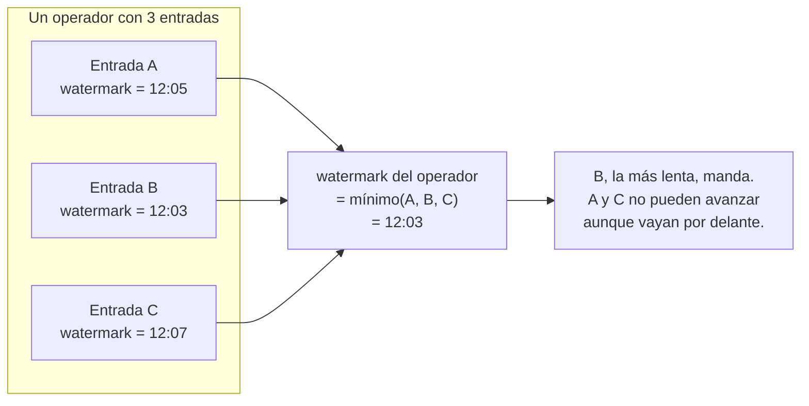

Con eso claro, hay dos preguntas distintas cuando una entrada no avanza, y la mayoría de la gente las
trata como una sola.

**¿Es un problema de reparto, o un problema de tráfico?**

El primero es estructural y permanente: si configuras más paralelismo del que hay particiones reales
en el topic de Kafka, los subtasks sobrantes no reciben ninguna partición, nunca, desde el segundo
uno, con tráfico perfecto o sin él. En este proyecto, `booking-events.v1` tiene una única partición
real. Si le hubiéramos dejado el paralelismo por defecto del job (4), tres de esos cuatro subtasks se
habrían quedado sin datos para siempre, y su watermark congelado habría arrastrado al operador
entero. El fix no es ningún mecanismo de tolerancia, es forzar `set_parallelism(1)` en ese operador
concreto. `with_idleness` no arregla esto; solo lo disimularía, dejando corriendo tres subtasks que
nunca iban a procesar nada.

El segundo es de tráfico real: una partición que sí tiene subtask asignado, pero que se queda sin
mensajes durante un rato porque, sencillamente, no hay eventos que publicar en ese instante. Aquí sí
hace falta `with_idleness`. Le dice a Flink "excluye a esta entrada del cálculo del mínimo mientras
no produzca nada", sin tocar el subtask ni liberar ningún recurso. En cuanto llega el siguiente
evento, vuelve a contar con normalidad.

**Cómo se te ocurriría mal fijar el umbral, y por qué está mal:** coger un número que "suena
razonable", 30 segundos, un minuto, lo que sea. La forma correcta es ir al código de la fuente real,
ver cuál es el intervalo *máximo* normal entre publicaciones (no el promedio, que esconde justo la
variabilidad que te interesa no confundir con un fallo), y multiplicarlo por un margen de seguridad,
típicamente 2x. Si no puedes justificar tu umbral señalando una línea de código concreta que define
la cadencia de la fuente, es un número inventado, y algún día te va a fallar en cualquier dirección:
demasiado corto y marcas tráfico sano como muerto, demasiado largo y tardas de más en detectar un
problema real.

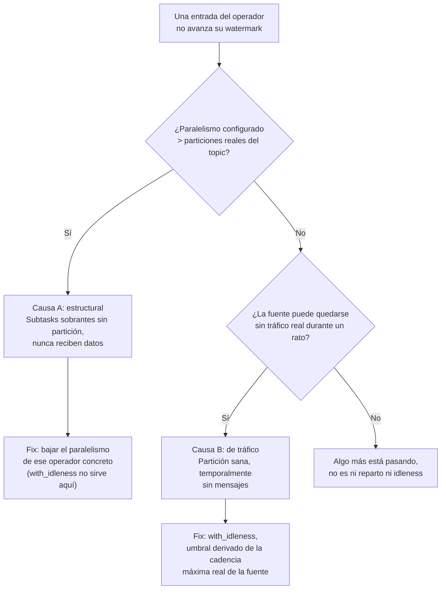

*Pregúntate: tu job deja de emitir resultados solo para un segmento. ¿Cómo distingues en cinco
minutos si es un problema de paralelismo mal configurado o de una fuente que se ha quedado callada?*
Respuesta corta: compara paralelismo configurado contra particiones reales del topic; si el
paralelismo es mayor, ya tienes la causa, sin necesidad de mirar nada más.

## Ventanas: el tamaño y la clave no son la misma decisión

Aquí es donde más gente mezcla dos ejes que no tienen nada que ver entre sí. El **tamaño** de la
ventana es "cada cuánto tiempo real emito un resultado". La **clave** es "qué hace a dos eventos
comparables dentro de esa ventana". Son ortogonales: puedes cambiar uno sin tocar el otro, y
confundirlos lleva a intentos de arreglo que no arreglan nada.

Pasó de verdad en este proyecto: la primera duda fue si agrupar el pulso de mercado solo por
`property_type`/`bedrooms`. Falla porque ignora la ubicación: un estudio en un barrio caro y uno en
un barrio barato no son comparables, aunque tengan el mismo número de habitaciones. La reacción
instintiva a ese fallo fue "pues hago un agregado más general, así engloba todo", y eso no resuelve
nada, porque el problema de fondo (si ponderar cada snapshot por su `sample_size` o no) es un
problema de **cómo se combina**, no de **cómo se agrupa**. Ampliar la clave no toca esa pregunta en
absoluto. Las dos decisiones se resolvieron por separado: la clave pasó a ser el segmento completo
(zona más tipo más habitaciones), y el agregado pasó a ser una media ponderada.

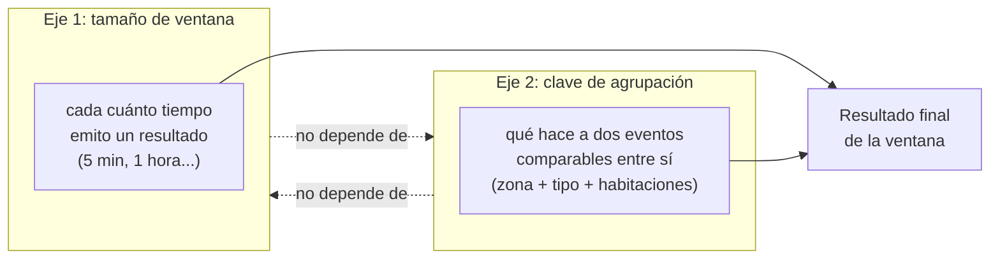

Cambiar uno de los dos ejes sin tocar el otro es perfectamente posible, y confundirlos (como intentar
arreglar un problema de ponderación ampliando la clave) es la trampa exacta que ilustra el diagrama.

## El acumulador: donde la aritmética te traiciona si no la escribes con números

Esta es la sección que más vale la pena dominar, porque el error es sutil y suena razonable hasta que
lo pruebas con cifras reales.

**Intento 1, media sin ponderar disfrazada de correcta:** sumar `avg_nightly_rate` y dividir por el
número de snapshots. Con tres snapshots `(rate=100, sample_size=50)`, `(100, 50)`, `(300, 2)`, esto
da `(100+100+300)/3 = 166.7`, dominado por el snapshot de solo 2 muestras, exactamente lo que se
quería evitar. La corrección: dos acumuladores separados, `Σ(rate · sample_size)` y `Σ(sample_size)`,
dividiendo uno entre el otro solo al final. Con los mismos datos: `10600 / 102 ≈ 103.9`.

**Intento 2, la media incremental, el error que casi nadie ve venir:** `nueva_media = (media_anterior
+ valor_nuevo) / n`. Suena a "voy incorporando información poco a poco", como cualquier otro
acumulador de este documento. Pruébalo con `[100, 100, 300]`:

- Evento 1: sin media anterior, `avg = 100`, `n = 1`.
- Evento 2: `avg = (100 + 100) / 2 = 100`.
- Evento 3: `avg = (100 + 300) / 3 = 133.3`.

La media real es `500/3 = 166.7`. El resultado, `133.3`, está mal, y esto es antes de meter ninguna
ponderación. El fallo de fondo: `media_anterior` ya es el resultado de dividir por `n-1` eventos;
sumarla directamente a un único valor nuevo y volver a dividir por `n` trata a la media acumulada y al
valor individual como si pesaran lo mismo, y no pesan lo mismo. **Regla general, sin excepciones:
acumula siempre sumas crudas, nunca una media a medio calcular, y divide una única vez en
`get_result()`.**

**El elemento identidad, la trampa del "no falla hoy por casualidad":** para `min`, el valor inicial
correcto es `+infinito`; para `max`, `-infinito`. La tentación es inicializar un máximo en `0`, y para
un campo de precio (que nunca es negativo por definición de schema) eso no falla nunca, hoy. Pero es
frágil: si el mismo patrón de acumulador se reutiliza para un `profit_eur`, que sí puede ser negativo,
y todos los valores de una ventana fueran negativos, `max(0, ...)` reportaría `0` como "máximo", un
valor que nunca ocurrió. `-infinito` es correcto siempre, sin depender de ninguna restricción externa
que podría cambiar mañana.

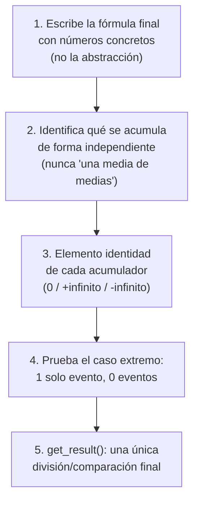

*Pregúntate: te piden una media ponderada por streaming, sin que el resultado pierda precisión a
medida que la ventana crece. ¿Cómo lo diseñas, en qué orden, y qué caso límite pruebas primero?*
Orden correcto: fórmula final con números concretos, luego identifica qué se acumula por separado,
luego el elemento identidad de cada acumulador, luego prueba con 1 evento y con 0 eventos, y una sola
división al final.

## Datos tardíos: nunca "se pierden en silencio"

Una vez que una ventana se dispara, ¿qué pasa con un evento que llega después? Hay tres capas, y
saltarse la de en medio es el bug más habitual. De hecho fue un bug real y no sembrado en este
proyecto: `allowedLateness` y el side output de datos tardíos estaban completamente ausentes del
código durante buena parte de la Fase 26, aunque el diseño del TTL de deduplicación (ventana más
lateness = 6 minutos) ya asumía que iban a existir.

1. **Dentro del margen de desorden esperado.** El watermark decide que la ventana está lista y se
   dispara.
2. **Después de eso, pero dentro de un margen de tolerancia explícito.** `allowedLateness`. Si el
   evento llega en este margen, la ventana se vuelve a disparar con el dato incluido, y como el sink
   escribe por `put_item` sobre la misma clave primaria (`apartment_id`, `window_start`), el segundo
   disparo simplemente sobreescribe al primero. No hace falta ningún mecanismo de "merge"; la
   idempotencia de la escritura ya resuelve la re-emisión.
3. **Después incluso de eso.** Nunca se descarta en silencio. Va a un side output (`OutputTag` +
   `.side_output_late_data(...)`), como mínimo logueado, idealmente auditable en una tabla propia. Un
   evento que desaparece sin dejar rastro es indistinguible de un bug que nadie detectó, y esa
   indistinguibilidad es justo el problema.

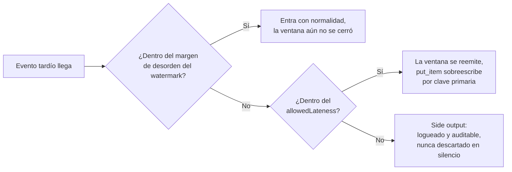

*Pregúntate: ¿por qué no basta con poner `allowedLateness` muy alto y olvidarte del side output?*
Porque siempre hay un margen finito de razonable, y algo tiene que pasar con lo que quede fuera:
subir el margen indefinidamente solo pospone el problema y además retrasa el cierre "real" de cada
ventana.

## Deduplicación: la pregunta que separa un estado propio de un contrato implícito con otra app

Cualquier fuente CDC puede reentregar el mismo evento de negocio más de una vez: redelivery de
Kafka, restart desde checkpoint, un resnapshot completo del conector. No todas las repeticiones pesan
igual, y tratarlas igual es un desperdicio de recursos.

- **Redelivery reciente** (event-time todavía dentro de ventana más lateness): puede corromper un
  resultado que Flink aún no ha cerrado. Necesita un mecanismo activo: `ValueState[bool]` por
  `booking_id`, con TTL corto.
- **Resnapshot completo** (event-time de semanas atrás): si tu `allowedLateness` es razonable, este
  caso **ya se descarta gratis** como "tarde", antes de llegar a ninguna lógica de deduplicación.
  Ponerle un TTL largo pensando en este caso solo paga crecimiento de estado sin necesidad real.

El intento que parece razonable y no lo es: usar `status` y `updated_at` para distinguir una reserva
nueva de una actualizada. `status` no distingue nada por sí solo: un `UPDATE` que solo cambia
`guests` en una reserva ya confirmada sigue llegando con `status == "confirmed"`, igual que la
primera confirmación. `updated_at IS NULL` sí funciona, pero con una grieta real: un resnapshot de
Debezium reemite la fila tal como está guardada, así que una fila que nunca se editó reaparece con
`updated_at = NULL`, indistinguible de un insert genuino. Y hay un problema más de fondo: `updated_at`
lo rellena un trigger de **otra** aplicación, no algo que tu job controle. Es exactamente el tipo de
contrato implícito sobre el comportamiento de un sistema ajeno que se rompe sin aviso el día que esa
aplicación cambia su trigger. **La pregunta de cierre, siempre: ¿la señal de "ya visto" depende solo
de tu propio estado, o de un campo que otra aplicación rellena por su cuenta?**

Y el bug sembrado que de verdad se coló en este proyecto, más tonto de lo que parece, y más fácil de
no ver de lo que crees: la condición estaba invertida, `if not self.seen_state.value(): return` en
vez de `if self.seen_state.value(): return`. Léelo dos veces. La lógica de "ya lo he visto, ignóralo"
se convierte en "no lo he visto, ignóralo" con solo una palabra de diferencia, y el código sigue
compilando, sigue corriendo, y solo falla en producción cuando alguien nota que el contador de
reservas creadas nunca sube.

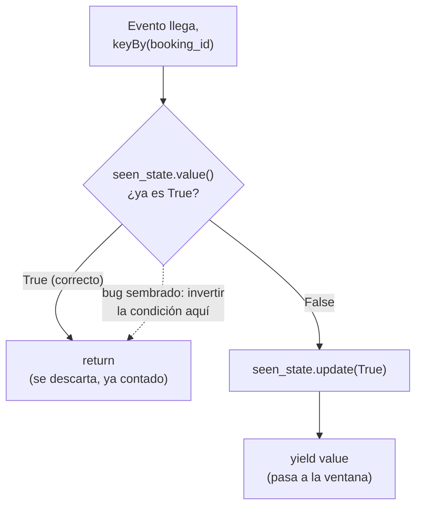

## Estado con clave y `KeyedProcessFunction`: sin red de seguridad automática

`keyBy` no mueve datos por sí solo, etiqueta el stream para que Flink sepa repartirlo, y a partir de
ahí cada clave tiene su propia instancia de estado, aislada de las demás. Piénsalo como un diccionario
que Flink gestiona por ti, con tres cosas que un dict de Python no te da gratis: persistencia a
prueba de fallos, redistribución si cambia el paralelismo, y TTL/timers por entrada.

Una ventana tiene un ciclo de vida automático: se abre, acumula, dispara, desaparece. Una
`KeyedProcessFunction` no tiene nada de eso, decides tú cuándo se crea el estado, cuándo se lee, y
sobre todo cuándo (si alguna vez) se borra. Esa libertad es exactamente lo que necesitas cuando la
pregunta no tiene un límite temporal natural ("¿he visto ya este `booking_id`?"), y exactamente lo que
te puede hundir si te olvidas del TTL: nada te limpia el estado, así que sin TTL crece para siempre,
más checkpoints, recuperación más lenta, presión sobre disco. **Regla práctica: si la pregunta tiene
un límite temporal que le importa al negocio ("cuántas en este tramo de 5 minutos"), usa una ventana.
Si es sobre identidad a lo largo del tiempo, sin límite natural, usa `KeyedProcessFunction` con TTL
explícito y justificado.**

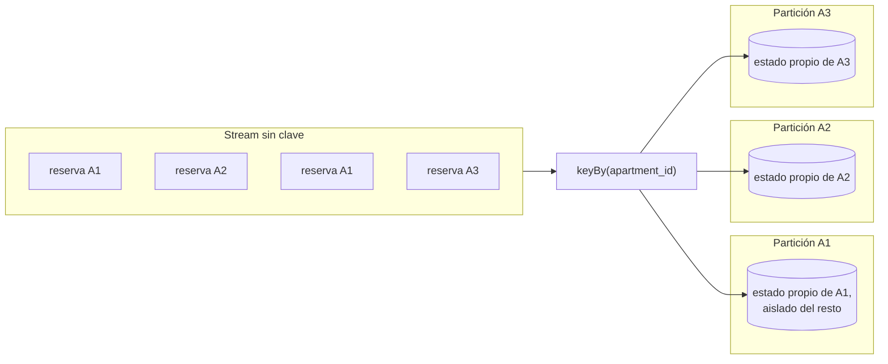

## Checkpointing: la barrera que atraviesa el grafo

Un checkpoint no es solo "Flink guarda una copia de vez en cuando", es un mecanismo con una
propiedad concreta que vale la pena poder dibujar en una pizarra. El JobManager inyecta una barrera en
los streams de origen; cada operador, al ver pasar la barrera, fotografía su propio estado en ese
instante exacto y reenvía la barrera hacia adelante. Cuando todos los operadores han confirmado su
fotografía, el checkpoint está completo. Eso es lo que garantiza `EXACTLY_ONCE`: no que cada operador
por separado procese una vez, sino que el estado de **todo el pipeline** refleja haber procesado cada
registro exactamente una vez, de forma consistente extremo a extremo.

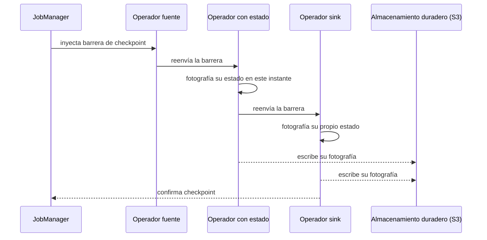

RocksDB (el state backend de este proyecto) responde a una pregunta distinta: dónde vive la copia
*viva* del estado entre checkpoint y checkpoint. Vive en disco local, embebido en el propio proceso
del TaskManager, no en memoria pura (que estaría acotada por RAM), no en una base remota (que
metería latencia de red). El checkpoint copia de ahí a S3/almacenamiento duradero, y de forma
incremental: solo los ficheros que cambiaron desde el último checkpoint, no todo el estado cada vez.

La pregunta que suena a trampa y no lo es: si cada acceso a RocksDB es más lento que uno en memoria,
¿por qué no es un cuello de botella? Cuatro razones que se combinan: la carga es casi toda escritura,
no lectura (el patrón exacto para el que un LSM-Tree está optimizado); el *block cache* mantiene en
RAM las claves calientes; los accesos son casi siempre point lookups por clave exacta, nunca rangos
(el caso fácil para un LSM-Tree); y no hay red de por medio, todo es local. Ninguna de las cuatro por
sí sola explicaría por qué no notas el coste, es la combinación.

## Backpressure: no es un error, es el sistema haciendo lo correcto

Backpressure es control de flujo basado en créditos: un operador downstream lento le comunica al
upstream que reduzca el ritmo, en vez de que el upstream siga empujando datos que nadie puede
procesar y el sistema se caiga por acumulación sin control. En este proyecto tienes un punto de
backpressure concreto y tangible, no abstracto: el `capacity` de
`AsyncDataStream.unordered_wait(...)`, el número máximo de llamadas de enriquecimiento en vuelo a la
vez contra DynamoDB. Si `capacity` es demasiado bajo, tu job va más lento de lo necesario aunque
DynamoDB pudiera con más carga. Si es demasiado alto, saturas la tabla remota o agotas
`ThreadPoolExecutor`. Es exactamente el mismo concepto que la métrica
`backPressuredTimeMsPerSecond` de Flink expone a nivel de operador, pero aquí lo controlas tú
directamente con un número.

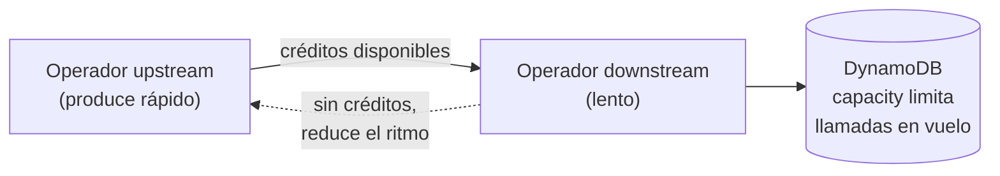

## Checkpoint vs savepoint: automático y de emergencia contra manual y planeado

Un checkpoint es automático, periódico, pensado para recuperación de fallos, no lo decides tú caso
por caso, corre solo cada X milisegundos. Un savepoint es manual y deliberado: lo disparas tú antes de
una operación planeada, un upgrade de versión del job, un cambio de paralelismo, una migración, y lo
usas como punto de partida explícito para el reinicio. La garantía de fondo es la misma
(exactly-once, basada en barreras); lo que cambia es la intención y quién lo dispara.

Y esto conecta directamente con la deduplicación de arriba: si tu job se reinicia desde un checkpoint
o un savepoint, Kafka va a reenviar eventos desde el último offset confirmado, algunos de esos
eventos ya se habían procesado antes del fallo. Si tu TTL de deduplicación cubre esa ventana de
reprocesamiento posible (ventana más lateness, como en este proyecto), el reinicio es seguro: el
estado de "ya visto" sigue ahí y el evento repetido se descarta sin contar dos veces. Si el retention
de Kafka fuera menor que ese TTL, tendrías un agujero: eventos que ya no se pueden releer si hiciera
falta, pero eso es un problema de retention, no de tu lógica de dedup.

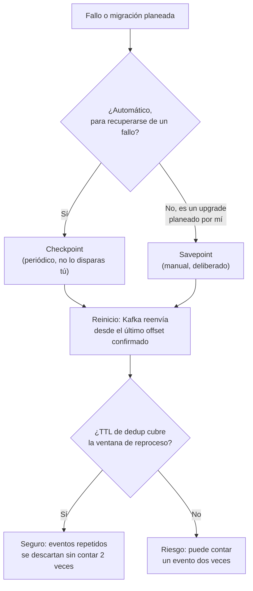

## Async I/O: por qué una llamada bloqueante mataría el throughput

Un `MapFunction` normal procesa un evento, y hasta que termina esa llamada no puede procesar el
siguiente. Si esa llamada es una petición de red (un `GetItem` a DynamoDB, por ejemplo), el
throughput del operador queda limitado por la latencia de esa llamada, evento a evento, sin
solapamiento. `AsyncDataStream.unordered_wait(stream, async_fn, timeout, capacity)` resuelve esto
dejando varias llamadas en vuelo a la vez, hasta `capacity` simultáneas, sin bloquear el hilo
principal del operador mientras esperan respuesta. `async_invoke()` es una corrutina que delega el
trabajo síncrono real (una llamada boto3) a un `ThreadPoolExecutor` vía `run_in_executor`, porque
boto3 en sí no es async. `unordered` significa que el orden de salida no tiene por qué coincidir con
el de entrada; si necesitas preservar orden, existe la variante `ordered`, al precio de más latencia
porque tiene que esperar a que termine la petición más lenta de un lote antes de emitir las que ya
terminaron.

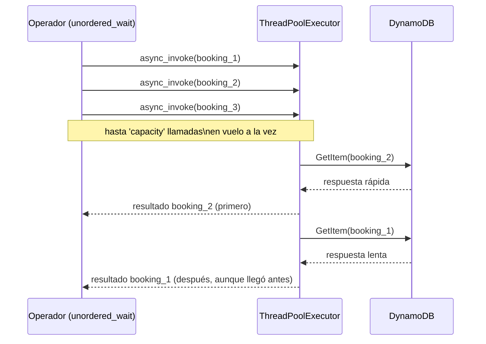

El bug sembrado real de este bloque, y el más fácil de cometer sin darte cuenta: los argumentos
`timeout` y `capacity` invertidos en la llamada. La firma es
`unordered_wait(stream, async_fn, timeout, capacity)`, y un `Time.seconds(5)` en la posición de
`capacity` y un `100` en la posición de `timeout` no da ningún error de tipos evidente si ambos son
simplemente objetos aceptados por la función; solo falla en comportamiento, de una forma que un test
unitario que no ejercite la ruta real de timeout puede no detectar. La lección: cuando una API acepta
dos parámetros del mismo "sabor" en posiciones adyacentes, comprueba la firma real (`inspect.signature`
si hace falta), no la memoria de cómo "sonaba" la última vez que la usaste.

## Glosario de conceptos y su tradeoff (la base de `tech-concepts/`)

Esta es la parte que más se pregunta y peor se explica: el nombre de un mecanismo sin el coste que
trae. Cualquiera puede decir "qué es" un watermark; pocos explican bien qué se paga por afinarlo mal
en cualquiera de las dos direcciones. Domina esta tabla y tendrás la base de
`windowing-design-checklist.md` y `keyed-state-and-checkpointing.md` lista para cualquier pregunta de
diseño.

| Concepto | Qué significa | Tradeoff |
|---|---|---|
| **Watermark** | Afirmación del sistema de "ya he visto todo lo que tiene event-time igual o anterior a T". | Más margen de desorden tolerado (`for_bounded_out_of_orderness` más alto) da menos falsos "tarde", pero cierra cada ventana más tarde, retrasando todos los resultados. Menos margen adelanta los resultados, pero arriesga tratar eventos legítimos como tardíos. |
| **`with_idleness`** | Excluye una entrada sin tráfico reciente del cálculo del mínimo de watermark, sin tocar el subtask. | Umbral corto detecta una fuente muerta rápido, pero puede marcar tráfico completamente normal como inactivo si la cadencia real varía. Umbral largo es más seguro frente a falsos positivos, pero tarda más en detectar el problema real. |
| **Paralelismo vs particiones reales** | Cuántos subtasks paralelos procesan una fuente frente a cuántas particiones tiene esa fuente de verdad. | Más paralelismo del que hay particiones no aporta throughput (los subtasks sobrantes nunca reciben datos) y además arrastra el watermark global con entradas permanentemente vacías; menos paralelismo del posible desaprovecha capacidad de proceso disponible. |
| **Allowed lateness** | Margen de tiempo tras el cierre de una ventana en que un evento tardío puede reabrirla y reemitir el resultado. | Más margen recupera más eventos legítimamente tardíos, a costa de mantener el estado de esa ventana vivo más tiempo y de que un resultado ya publicado pueda cambiar después. Sin margen, cualquier evento tardío se pierde en el instante en que se cierra la ventana. |
| **Side output de datos tardíos** | Destino explícito para lo que llega después incluso del margen de `allowedLateness`, en vez de descartarlo en silencio. | Coste casi nulo de implementar, pero es lo primero que se olvida al diseñar una ventana, precisamente porque "el caso feliz" nunca lo necesita hasta que algo falla de verdad. |
| **Tamaño de ventana** | La granularidad temporal de cada resultado emitido (5 min, 1 hora...). | Ventanas pequeñas dan resultados más frescos, pero con muestras más pequeñas y por tanto más ruidosas. Ventanas grandes son más estables estadísticamente, pero reaccionan más despacio a un cambio real. |
| **Discarding vs accumulating (How)** | Si el resultado de una ventana es independiente de los disparos anteriores de la misma clave, o si hace falta relacionarlos. | Discarding es más simple de razonar y de implementar, pero no permite "corregir" un resultado ya emitido salvo por sobreescritura total. Accumulating permite relacionar disparos sucesivos, pero exige lógica de retracción, bastante más compleja y fácil de hacer mal. |
| **Elemento identidad del acumulador** | El valor inicial de un acumulador antes del primer evento (`0` para sumas, `+infinito` para mínimos, `-infinito` para máximos). | Usar el valor "que no falla hoy" (como `0` para un máximo, confiando en que el dominio nunca es negativo) ahorra pensar en el caso general, pero es frágil ante cualquier cambio futuro de ese dominio. El elemento identidad matemáticamente correcto cuesta un segundo más de pensar y no falla nunca. |
| **Estado con clave (`keyBy` + `ValueState`/`MapState`)** | Una instancia de estado aislada por cada valor de clave, gestionada, persistida y escalada por el motor. | Da aislamiento perfecto entre claves y persistencia gratuita frente a un fallo, pero nada te limpia ese estado automáticamente: sin un TTL explícito, crece sin límite para siempre. |
| **TTL de estado** | Expiración automática de una entrada de estado tras un tiempo sin actualizarse. | TTL corto mantiene el estado acotado, pero arriesga "olvidar" algo que todavía hacía falta, por ejemplo, un replay legítimo tras un fallo que tarda más que el TTL en llegar. TTL largo o ausente es más seguro frente a ese caso, pero se paga en crecimiento de estado, checkpoints más grandes y recuperación más lenta. |
| **State backend: heap/hashmap vs RocksDB** | Dónde vive la copia de trabajo del estado mientras el job corre. | El backend en memoria (heap) es más rápido de leer y escribir, pero el tamaño del estado queda acotado por la RAM disponible. RocksDB es más lento por acceso (serialización más I/O de disco), pero el estado puede crecer hasta el límite del disco local y permite checkpoints incrementales. |
| **Checkpoint incremental** | Cada checkpoint copia al almacenamiento duradero solo los ficheros que cambiaron desde el anterior, no todo el estado. | Mucho más barato en tiempo y ancho de banda que un snapshot completo en cada intervalo, pero la recuperación depende de una cadena de incrementales bien conservada, más compleja de razonar que un único snapshot autocontenido. |
| **Checkpoint vs savepoint** | Automático y periódico (checkpoint, para recuperación de fallos) frente a manual y planeado (savepoint, para una migración deliberada). | El checkpoint no exige ninguna acción humana, pero no está pensado como punto de partida para un cambio de versión o de paralelismo. El savepoint sí lo permite, pero hay que acordarse de dispararlo antes de la operación planeada; no ocurre solo. |
| **`AsyncDataStream` `capacity`** | Número máximo de llamadas externas en vuelo simultáneamente desde un operador de Async I/O. | `capacity` baja limita el throughput del job aunque el servicio externo pudiera aguantar más carga. `capacity` alta maximiza throughput, pero puede saturar el servicio externo o agotar el pool de hilos que ejecuta las llamadas síncronas de verdad. |
| **`unordered` vs `ordered` en Async I/O** | Si el orden de salida de los resultados enriquecidos tiene que coincidir con el orden de entrada. | `unordered` da mayor throughput porque cada resultado sale en cuanto termina su llamada, sin esperar a nadie más, pero pierde el orden original. `ordered` preserva el orden, a costa de que todo un lote espere a la petición más lenta antes de poder emitir nada. |
| **Backpressure** | Control de flujo basado en créditos: un operador lento le pide al anterior que reduzca el ritmo, en vez de acumular sin control. | Sin backpressure, un operador lento provoca una acumulación descontrolada aguas arriba que puede tirar el job entero. Con backpressure, el throughput de todo el pipeline queda limitado por el operador más lento, lo cual protege el sistema pero no lo hace ir más rápido: solo evita que se caiga. |

## Incidentes reales: el catálogo que demuestra que has depurado algo, no que lo has leído

Ten dos o tres de estos preparados de memoria, con la secuencia síntoma, causa, fix, no la teoría
alrededor:

- **Zookeeper `NodeExistsException` al reiniciar Kafka.** Síntoma: Kafka no arranca tras un
  `docker compose down`/`up` sucio. Causa: un znode efímero de broker que sobrevivió a un shutdown no
  limpio. Fix: esperar a que expire la sesión antigua de ZK y reintentar el arranque de Kafka solo,
  antes de levantar el resto del stack.
- **`NoResourceAvailableException`.** Síntoma: un segundo job de Flink no arranca aunque el primero
  corre bien. Causa: el TaskManager tiene un número fijo de slots (4 en este proyecto) y la suma de
  paralelismos de ambos jobs lo supera. Fix real aplicado aquí: bajar temporalmente la carga
  cancelando un job para poder verificar el otro, documentado explícitamente como limitación de
  infraestructura, no escondido.
- **Variable de entorno de DynamoDB ausente.** Síntoma: `UnrecognizedClientException: The security
  token included in the request is invalid` en un `put_item`. Causa nada obvia a primera vista, pero
  con la traza exacta apunta a que el cliente boto3 estaba intentando hablar con AWS real (con
  credenciales falsas) en vez de con LocalStack: la variable `..._DYNAMODB_ENDPOINT_URL` sencillamente
  no estaba en el `docker-compose.yml` para este job nuevo, aunque el job hermano sí la tenía. Fix:
  añadir la variable, recrear jobmanager y taskmanager, resubmitir. La lección de fondo: cuando copias
  la infraestructura de un job existente para uno nuevo, compara variable a variable, no confíes en
  que "el patrón ya está copiado".
- **Un contenedor corriendo una imagen vieja.** Síntoma: una función que existe en el código fuente
  en disco no aparece cuando la buscas dentro del contenedor en ejecución
  (`docker exec ... grep -c nombre_funcion fichero.py` devuelve 0). Causa: el contenedor nunca se
  reconstruyó tras el último cambio de código. Fix: rebuild más `--force-recreate`, y verificar de
  nuevo dentro del contenedor, no solo en disco, antes de dar el bug por resuelto.
- **Flink 2.x elimina el `SourceFunction` legado.** Consecuencia directa: `FlinkKinesisConsumer` (que
  depende de esa interfaz) deja de existir como opción, de ahí que este proyecto tenga un bridge
  Kinesis a Kafka en vez de un conector nativo de Kinesis para Flink. No es una preferencia estética;
  es una limitación real de la versión del motor.

*Pregúntate, y ten la respuesta lista sin dudar: cuéntame un incidente real de streaming que hayas
depurado, qué viste primero, cómo llegaste a la causa, qué cambiaste.* Usa el de `booking-events`
con una sola partición como tu ejemplo estrella: es tuyo, es concreto, y toca watermarks, paralelismo
y diseño de fuente a la vez.
