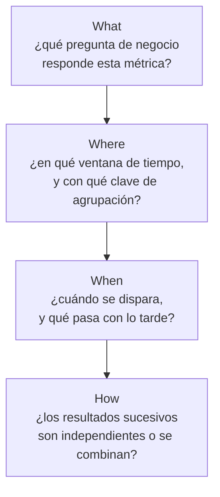
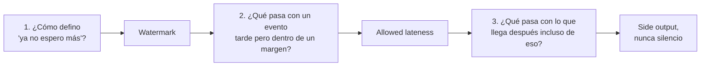
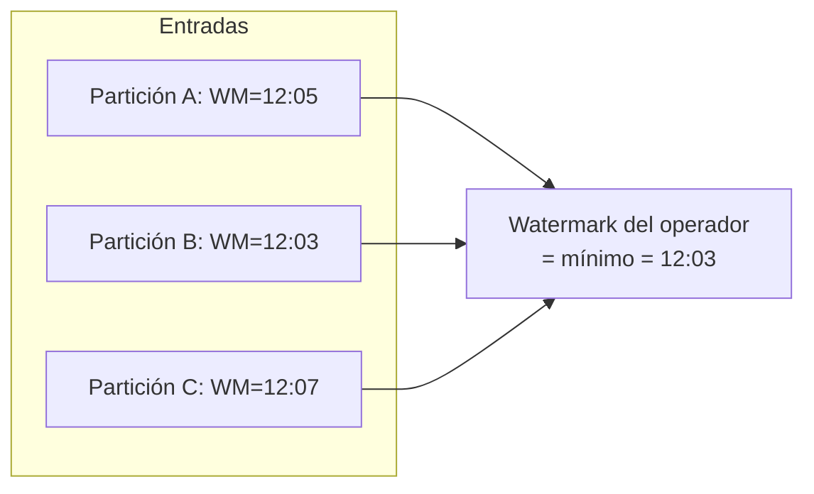
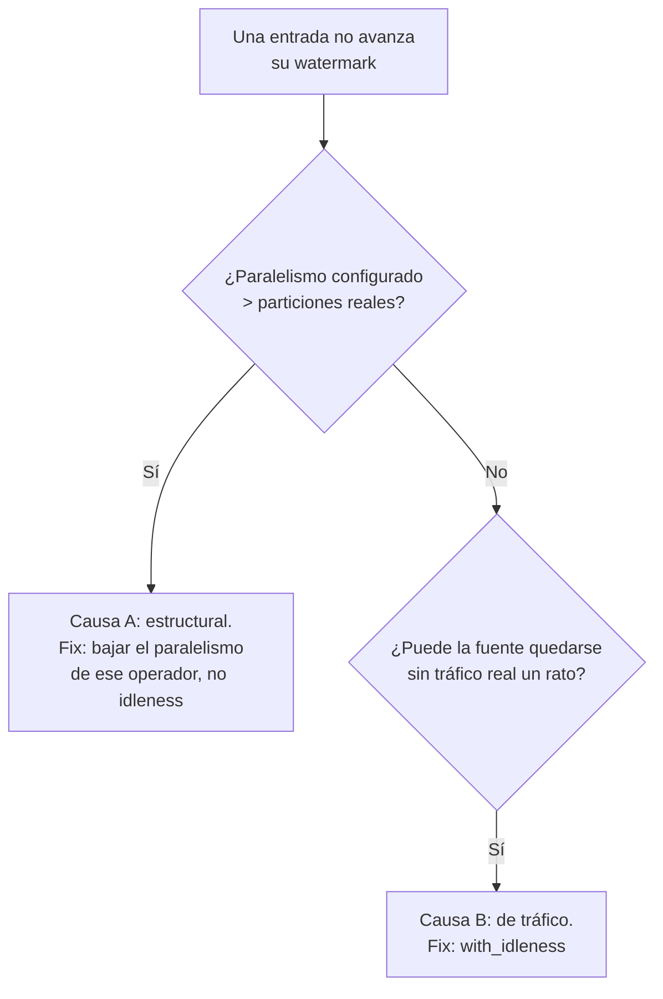
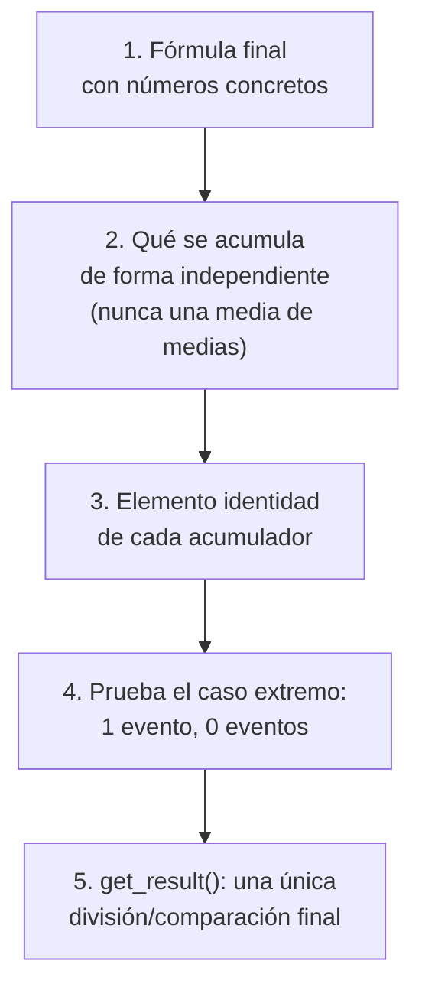
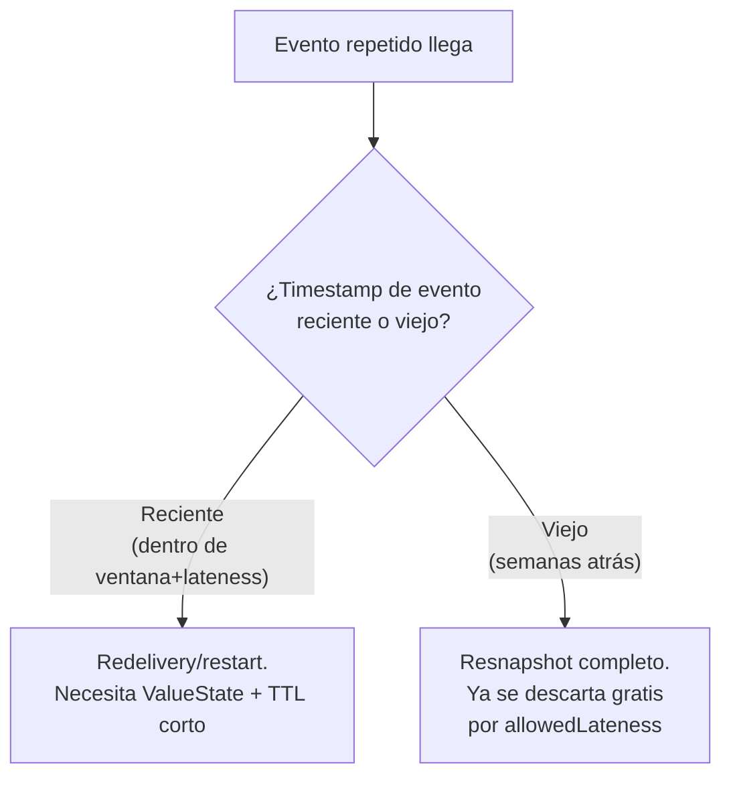
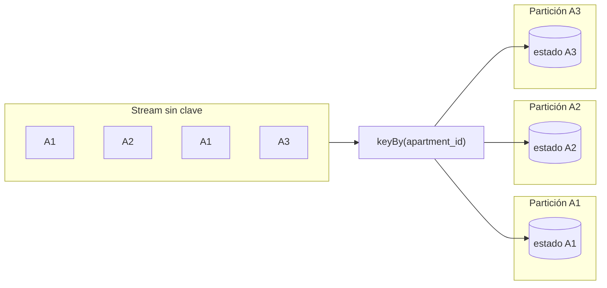
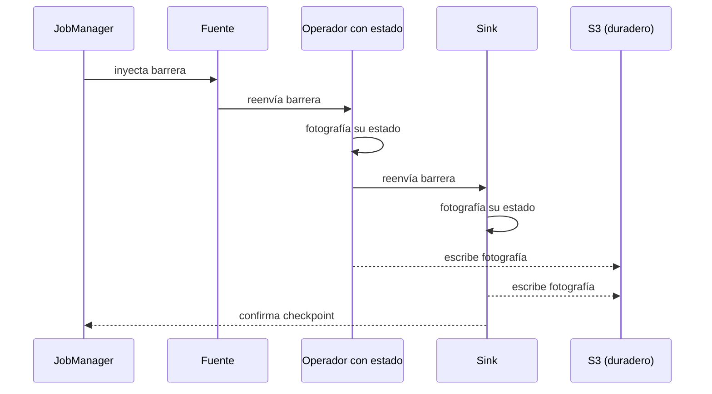
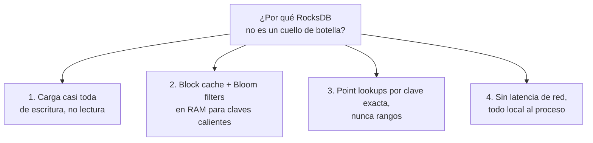

# Tech concepts, fusionado: el modelo mental completo de ventanas y estado

Este fichero fusiona los dos documentos de `docs/tech-concepts/` (`windowing-design-checklist.md` y
`keyed-state-and-checkpointing.md`) en una sola narrativa, con ejemplos numéricos, el tradeoff de
cada decisión, y un diagrama Mermaid en cada bloque que lo necesita. Es el material que estos dos
ficheros considera "lo más importante para aprender": el modelo mental que hay que tener antes de
escribir una sola línea de una spec de ventaneo, y antes de escribir una `KeyedProcessFunction`.

No repite `streaming-mastery.md` palabra por palabra: aquí el foco es el razonamiento de diseño
completo, de principio a fin, con el proceso de decisión explícito en cada paso. Si `streaming-
mastery.md` es "qué se te olvida y te hace parecer junior", este fichero es "cómo se razona una
decisión de ventaneo desde cero, con el método completo delante".

---

## Parte 1: las 4 preguntas del Dataflow Model

Antes de escribir una spec de ventana, hay que responder cuatro preguntas, en este orden exacto,
porque cada una depende de la anterior. Vienen de dos fuentes que se combinan en este proyecto: "The
Dataflow Model" (Akidau et al., Google, VLDB 2015), el paper que formalizó el diseño de computación
por ventanas, y Kleppmann, *Designing Data-Intensive Applications* (cap. 11), para los conceptos de
eventos tardíos, reprocesamiento e idempotencia.

### What: ¿qué se está calculando, de verdad?

No es "qué campo agrego", es "¿qué pregunta de negocio responde este número, y a quién sirve?". En
este proyecto, la pregunta inicial fue mal planteada como "avg(avg_nightly_rate)"; la pregunta real
era "¿qué nivel de precio se pide ahora mismo para este segmento?", y esa reformulación fue la que
reveló que un `avg()` sin ponderar por `sample_size` no la respondía bien.

**Tradeoff:** invertir tiempo en definir bien el "what" cuesta tiempo de diseño por adelantado, pero
evita construir un acumulador entero (con su propia lógica de agregación, su propio schema, su propio
sink) sobre una pregunta de negocio mal planteada, que luego hay que rehacer entera.

### Where: tamaño de ventana y clave, dos decisiones que no son la misma

**Tradeoff del tamaño:** una ventana pequeña da resultados más frescos, pero con muestras menores y
más ruido estadístico. Una ventana grande es más estable, pero reacciona más despacio a un cambio
real del negocio.

**Tradeoff de la clave:** agrupar por menos atributos (una clave más amplia) da más muestra por grupo
y resultados más estables, pero arriesga mezclar cosas que un humano consideraría incomparables (un
estudio de un barrio caro con uno de un barrio barato). Agrupar por más atributos (una clave más
estrecha) da comparabilidad real, pero cada grupo tiene menos muestra y el resultado es más volátil.

**Pregúntate para la clave:** si agrupo por X pero no por Y, ¿estoy mezclando cosas que un humano
consideraría incomparables? **Pregúntate para el tamaño:** ¿el tamaño de ventana tiene relación con
la frecuencia real de publicación de la fuente, verificada en código?

### When: watermarks, allowed lateness, y qué pasa con lo tarde

Esta es la pregunta donde entra Kleppmann de lleno: en un sistema real, los eventos no llegan en el
orden en que ocurrieron. Tres decisiones concretas, en este orden:

1. **Watermark.** `for_bounded_out_of_orderness(D)` es la respuesta más simple: "espero como mucho D
   de desorden". Pero solo funciona si todas las particiones de entrada producen tráfico con
   regularidad. **Tradeoff:** un `D` alto tolera más desorden real sin perder eventos, pero retrasa el
   cierre de toda ventana. Un `D` bajo cierra antes, pero trata más eventos legítimos como tardíos.
2. **Allowed lateness.** Si un evento llega después de que su ventana ya se disparó pero dentro de un
   margen razonable, la ventana se vuelve a disparar y reemite. **Tradeoff:** más margen recupera más
   eventos tardíos legítimos, a costa de mantener vivo el estado de esa ventana más tiempo y de que un
   resultado ya publicado pueda cambiar después.
3. **Fuera de ese margen.** Nunca se descarta en silencio: un side output logueado, como mínimo, mejor
   aún una tabla auditable. **Tradeoff:** el coste de implementarlo es casi nulo; el coste real es que
   es lo primero que se olvida, porque "el caso feliz" nunca lo necesita hasta que algo falla.

### How: ¿los resultados sucesivos de la misma clave se combinan o son independientes?

Esta es la pregunta que casi siempre se salta. Discarding: cada disparo de una ventana es
independiente de los anteriores de la misma clave. Accumulating: hay que tener en cuenta lo ya
emitido. En este proyecto, se descartó explícitamente que una cancelación "retractara" un conteo de
creación ya emitido (no hay mecanismo de retracción pasado el `allowedLateness`), y en su lugar se
diseñaron dos contadores independientes, dejando el neto para tiempo de consulta.

**Tradeoff:** discarding es mucho más simple de razonar e implementar, pero no permite corregir un
resultado ya cerrado salvo por sobreescritura total. Accumulating permite relacionar disparos
sucesivos (por ejemplo, un neto real), pero exige lógica de retracción, bastante más compleja y fácil
de hacer mal.

---

## Parte 2: watermarks, particiones y `with_idleness` a fondo

### La regla del mínimo

El watermark de un operador con varias entradas es el mínimo entre todas ellas, nunca la media. Es
deliberadamente pesimista: si asumiera que las entradas rápidas representan al conjunto, arriesgaría
cerrar una ventana antes de que le llegara un evento tardío que sí le correspondía.

**Tradeoff de fondo:** esta regla es la raíz de todos los problemas de watermark que vas a depurar.
Cualquier entrada que deje de producir watermark, por la razón que sea, arrastra hacia abajo el
watermark de todo el operador, aunque el resto funcione perfectamente. Es el precio de la seguridad:
la alternativa (usar la media o el máximo) sería más rápida pero perdería eventos tardíos legítimos
sin avisar.

### Dos causas distintas de que una entrada no avance

**Causa A, estructural: más subtasks que particiones reales.** Kafka asigna cada partición a
exactamente un subtask, de forma fija al arrancar el job. Si el job tiene más subtasks que
particiones, los sobrantes no reciben ningún evento, desde el instante en que arranca, sin relación
con si hay tráfico real. Es un fallo permanente y garantizado, no intermitente.

**Causa B, de tráfico real: una partición con subtask asignado que deja de recibir mensajes durante un
rato.** Aquí sí hace falta `with_idleness`: marca esa entrada como inactiva tras un umbral, y mientras
dure, la excluye del cálculo del mínimo.

**Tradeoff de `with_idleness` en sí:** aplicarlo sobre la causa A la disimularía (el watermark
avanzaría igual, excluyendo los subtasks vacíos) pero dejaría corriendo recursos que nunca van a
procesar nada, en vez de eliminar la causa real. Aplicado sobre la causa B correcta, no tiene coste
real más allá de la latencia de detección que introduce el propio umbral.

### Cómo fijar el umbral de `with_idleness` sin adivinar

1. Busca la cadencia real de publicación de la fuente en el código, nunca en una suposición.
2. Toma el intervalo **máximo** normal (no el promedio, que esconde la variabilidad real) y
   multiplícalo por un margen de seguridad, típicamente 2x.
3. Documéntalo como configuración explícita, no como una constante suelta.
4. Decide cómo vas a monitorizar que el mecanismo funciona (métricas de watermark por operador, o
   acumulación anómala en el side output de datos tardíos).

**Tradeoff del umbral:** demasiado corto marca tráfico sano como muerto (falsos positivos); demasiado
largo tarda de más en detectar un problema real (falsos negativos, en el sentido de detección tardía).
No hay un valor "seguro por defecto": depende de la cadencia real medida.

---

## Parte 3: el `AggregateFunction`, encontrar el elemento identidad

Una vez resueltas las 4 preguntas, si el resultado es una agregación, el patrón para no perder
precisión es siempre el mismo orden:

### La regla de oro del elemento identidad

| Operación | Valor inicial correcto | Tradeoff de elegir mal |
|---|---|---|
| `+=` (suma, conteo, peso) | `0` | Sumar `0` no cambia nada; no hay elección incorrecta razonable aquí. |
| `min(...)` | `+infinito` | Empezar en un valor finito arbitrario puede "ganar" incorrectamente frente al primer evento real si ese valor es menor que todos los datos reales. |
| `max(...)` | `-infinito`, nunca `0` "porque hoy no falla" | `0` funciona mientras el dominio actual (p. ej. un precio `≥0`) lo permita por casualidad, pero es frágil: si el mismo acumulador se reutiliza para un campo que sí admite negativos (`profit_eur`) y todos los valores de una ventana fueran negativos, `max(0, ...)` reportaría `0` como "máximo", un valor que nunca ocurrió. `-infinito` es correcto siempre, sin depender de una restricción externa que podría cambiar. |

### Trampa común: una media incremental está mal, aunque suene razonable

`nueva_media = (media_anterior + valor_nuevo) / n` suena a "incorporar información poco a poco". Con
`[100, 100, 300]`:

- Evento 1: `avg = 100`, `n = 1`.
- Evento 2: `avg = (100 + 100) / 2 = 100`.
- Evento 3: `avg = (100 + 300) / 3 = 133.3`.

La media real es `500/3 = 166.7`. El resultado, `133.3`, está mal, antes incluso de ponderar nada. El
fallo: `media_anterior` ya está dividida por `n-1` eventos; sumarla directamente a un valor nuevo y
volver a dividir por `n` trata a ambos como si pesaran lo mismo, y no pesan lo mismo.

**Regla, sin excepciones:** acumula siempre sumas crudas (`Σvalor`, `Σpeso`), nunca una media a medio
calcular, y divide una única vez en `get_result()`.

### Ejemplo completo: media ponderada, con el desliz de aritmética real incluido

Con snapshots `(rate=100, sample_size=50)`, `(100, 50)`, `(300, 2)`:

- Media sin ponderar: `(100+100+300)/3 = 166.7`, dominada por el snapshot de solo 2 muestras.
- Media ponderada correcta: `Σ(rate · sample_size) / Σ(sample_size) = 10600 / 102 ≈ 103.9`.

**Tradeoff de ponderar:** una media ponderada exige llevar dos acumuladores en vez de uno y es algo
más cara de razonar, pero evita que un dato de baja confianza (`sample_size=2`) pese lo mismo que uno
de alta confianza (`sample_size=50`). El desliz real que ocurrió durante el diseño de este proyecto
(`300 × 20` en vez de `300 × 2`, un `sample_size` mal leído) no fue un error de método, fue un error
de dato de entrada, exactamente el tipo de fallo que el paso 1 del proceso (números concretos, no
abstracción) hace visible de inmediato al comparar contra un resultado ya conocido.

---

## Parte 4: deduplicación e idempotencia

Cualquier fuente CDC puede reentregar el mismo evento más de una vez: redelivery de Kafka, restart
desde checkpoint, o un resnapshot completo del conector. No todos los casos necesitan la misma
defensa.

**Tradeoff del TTL de dedup:** demasiado corto y cuentas de menos (el estado expira antes de un replay
legítimo). Demasiado largo o pensado para cubrir resnapshots completos, y lo pagas en crecimiento de
estado sin necesidad real, porque ese caso ya se filtra gratis por el lateness.

**La pregunta de cierre, siempre:** ¿la señal de "ya visto" depende solo de tu propio estado, o de un
campo que otra aplicación rellena por su cuenta? `updated_at IS NULL` parece razonable para distinguir
un insert de un update, pero se rompe con un resnapshot de Debezium (una fila nunca editada reaparece
con `updated_at = NULL`, indistinguible de un insert genuino) y depende de un trigger ajeno que puede
cambiar sin aviso. La alternativa correcta: `ValueState[bool]` por identidad propia del evento, nunca
un campo de otra aplicación.

---

## Parte 5: estado con clave, `KeyedProcessFunction` y checkpointing

### `keyBy`: una partición lógica, no un movimiento de datos

`key_by(lambda x: x.apartment_id)` etiqueta el stream para que Flink sepa repartirlo. A partir de ahí,
cada valor de clave tiene su propia instancia de estado, aislada del resto.

**Tradeoff frente a un dict de Python:** Flink te da persistencia a prueba de fallos, redistribución
automática si cambia el paralelismo, y TTL/timers por entrada, todo gratis. A cambio, cada acceso
pasa por una capa de serialización y gestión de estado que un dict en memoria pura no tiene.

### Ventana vs `KeyedProcessFunction`: ciclo de vida automático vs manual

Una ventana se abre, acumula, dispara y desaparece sola. Una `KeyedProcessFunction` no tiene nada de
eso: decides tú cuándo se crea, se lee y se borra el estado.

| | Ventana | `KeyedProcessFunction` |
|---|---|---|
| **Ciclo de vida** | Automático, gestionado por Flink | Manual, lo decides tú entero |
| **Qué gana** | Garantía de fábrica: un disparo por clave y ventana, en orden | Estado que vive tanto como haga falta, sin límite temporal fijo |
| **Qué paga** | No permite fácilmente "rectificar" tras el disparo sin allowedLateness | Nada limpia el estado solo; sin TTL explícito, crece para siempre |
| **Cuándo usarla** | La pregunta tiene un límite temporal que le importa al negocio ("cuántas en 5 min") | La pregunta es de identidad a lo largo del tiempo ("¿he visto ya este ID?") |

### Checkpointing: la barrera que atraviesa el grafo

Esto garantiza `EXACTLY_ONCE`: no que cada operador aislado procese una vez, sino que el estado de
**todo el pipeline** refleja haber procesado cada registro exactamente una vez, de forma consistente
extremo a extremo.

### State backend: heap vs RocksDB

| Backend | Dónde vive el estado en vivo | Tradeoff |
|---|---|---|
| **Heap (hashmap)** | Objetos en memoria pura de la JVM | Lecturas/escrituras muy rápidas, pero el tamaño del estado queda acotado por la RAM disponible: bien para un espacio de claves pequeño, peligroso si el estado crece sin límite. |
| **RocksDB** (este proyecto) | Disco local, embebido en el TaskManager | Cada acceso es más lento (serialización más I/O de disco), pero el tamaño del estado queda acotado por el disco, no por la RAM, y permite checkpoints incrementales (solo se copian los ficheros que cambiaron). |

**Por qué RocksDB no es un cuello de botella aquí, con las 4 razones combinadas:**

Ninguna de las cuatro por sí sola explica el resultado. La combinación de las cuatro es lo que hace
que un LSM-Tree (la estructura de RocksDB) encaje casi perfectamente con el patrón de acceso real de
un operador con estado de Flink, muy distinto del patrón de una base de datos OLTP tradicional donde
sí importa la latencia de lectura porque hay un usuario esperando.

---

## Checklist final, para copiar y rellenar en la siguiente spec de ventana

- **What:** ¿qué pregunta de negocio responde esta métrica, en una frase que entendería quien la use,
  sin matices?
- **Where (clave):** ¿qué atributos hacen a dos eventos comparables? ¿Estoy mezclando algo que un
  humano consideraría distinto?
- **Where (tamaño):** ¿el tamaño de ventana tiene relación con la cadencia real de publicación de la
  fuente, verificada en código, no supuesta?
- **When (watermark):** ¿cuántas particiones tiene la fuente real? ¿Puede alguna quedarse sin tráfico
  y bloquear el avance del watermark? ¿Hace falta `with_idleness`, con qué umbral derivado de datos
  reales?
- **When (lateness):** ¿qué pasa con un evento tarde dentro del margen? ¿Y fuera del margen, dónde
  queda registrado, nunca solo descartado en silencio?
- **How:** ¿el resultado de una ventana es independiente de las demás, o necesito relacionar disparos
  sucesivos? ¿Hay algún caso que "querría" retractar un resultado ya cerrado, y cómo lo resuelvo sin
  retracción?
- **Acumulador (si aplica):** fórmula final con números concretos primero. Elemento identidad correcto
  para cada campo, no el que "no falla hoy por casualidad". Probado contra 1 evento y 0 eventos.
- **Deduplicación (si aplica):** ¿de qué casos me protejo, redelivery reciente o resnapshot viejo? ¿El
  mecanismo depende solo de mi propio estado, o de un contrato implícito de otra aplicación?
- **Estado (si aplica):** ¿la pregunta tiene un límite temporal natural (ventana) o es sobre identidad
  a lo largo del tiempo (`KeyedProcessFunction` con TTL)?
